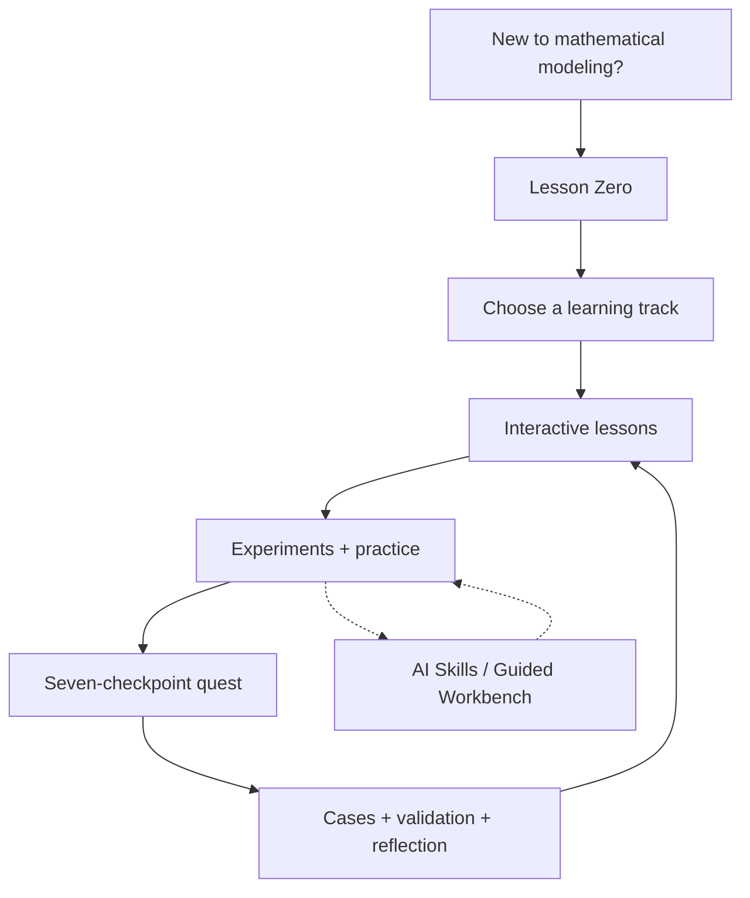
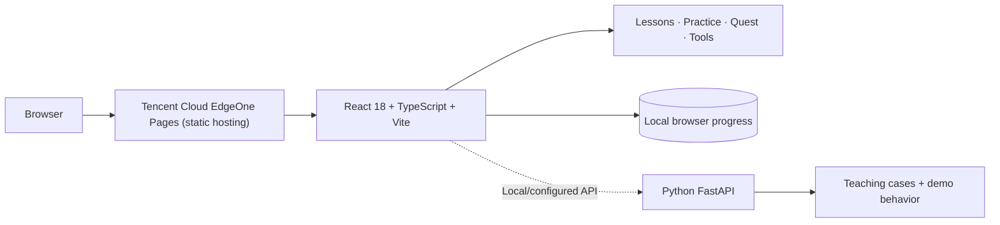

<div align="center">

# ModelingBridge · 模桥

### From a question you cannot decode to a model you can defend.
**From Confusion to Models. From Models to Solutions.**

**An interactive learning space built for the next generation of mathematical modelers.**  
Learn not only **which model to use**, but **why it fits, how it works, and when to question the result**.

[🌐 Live Website](https://www.modelingbridge.cc) · [📚 Start Learning](https://www.modelingbridge.cc/learn) · [🧩 Modeling Quest](https://www.modelingbridge.cc/quest) · [🇨🇳 简体中文](README.md)


**Created & Led by [@Xiaotian69](https://github.com/Xiaotian69)**

[](https://www.modelingbridge.cc)

</div>

> 📌 **This is the ModelingBridge V3.0 early public snapshot.** The repository preserves the complete source code of the early V3.0 release for showcase and learning; its AI features run in demo mode, and the real AI service is not included in this public snapshot. ModelingBridge is still under active development, and future versions are not guaranteed to be published here. For the latest progress and to try what is live today, visit **[www.modelingbridge.cc](https://www.modelingbridge.cc)**.


<sub>The interface shown in this cover is the early MVP guided workbench, not the current V3.0 UI. For the latest experience, [open the website](https://www.modelingbridge.cc).</sub>

> **In one sentence:** ModelingBridge turns mathematical modeling from a collection of formulas and templates into a journey of exploration, experimentation, practice, and reflection.

---

## ✨ Why ModelingBridge?

A common first encounter with mathematical modeling looks like this:

- The problem statement is long, and you do not know where to start.
- You recognize names like linear programming, AHP, and TOPSIS—but not when to use them.
- Your code runs, yet you cannot confidently defend the assumptions behind it.
- You have bookmarks, slides, and PDFs everywhere, but no coherent learning path.
- You want to join a modeling competition, yet struggle to connect theory with practice.

**ModelingBridge is not another pile of resources or a one-click paper generator.**

It is an attempt to connect the learning process end to end:

**Understand → Build Intuition → Experiment → Practice → Model → Validate → Reflect**

Instead of watching an answer appear, learners make—and examine—the decisions along the way.

## 🚀 ModelingBridge V3.0 at a Glance

| What you can explore | Why it matters |
| --- | --- |
| 🎒 **Lesson Zero** | Starting from a rainy-day umbrella allocation problem, walk through objectives, variables, assumptions, solving, validation, and improvement before learning advanced methods |
| 📐 **Five interactive courses** | Linear Programming, AHP, TOPSIS / Entropy Weighting, Regression, and Graph / Network Optimization |
| 🧪 **Hands-on experiments** | Observe how assumptions, constraints, weights, or data can change a conclusion; Linear Programming also has a dedicated interactive lab |
| 📝 **Topic-focused practice** | Each of the five courses has matching exercises with layered hints, feedback, and retries |
| 🧭 **Seven-checkpoint modeling quest** | Go from first reading of a problem to a paper outline through a complete, traceable process |
| 🧠 **AI Skills and a guided workbench** | Use structured prompts and checklists; the workbench runs in teaching-demo mode in this snapshot |
| 📅 **Competition calendar** | Organize key dates while distinguishing officially announced, unverified, and projected entries |
| 📁 **Cases and resource index** | Find original learning content and links to official sources |
| 💾 **Local learning progress** | No sign-up; resume learning on the same browser and revisit your work |

> **Release boundary:** The public website currently delivers a deployed static frontend experience and is in a free trial phase. **AI features in this public version run in demo mode: the real AI service is not included in this public snapshot.** The backend contains no code that calls a paid model, so it returns teaching demo results even if an API key is configured. Cloud accounts and automatically refreshed competition data are not included either.

## 🧭 Your Modeling Learning Journey



**Best starting point:** [Lesson Zero — Introduction to Mathematical Modeling](https://www.modelingbridge.cc/learn/introduction).

### 01 · Start With Intuition, Not Jargon

Lesson Zero takes about 15–20 minutes and opens with a rainy-day question: how should a limited supply of umbrellas be allocated? Through it, learners meet objectives, decision variables, assumptions, solutions, validation, and iteration—building the modeling mindset before encountering a full toolkit.

No programming language or algorithm is required up front. Learners with some background can skip straight to any course.

### 02 · Five Courses, Five Ways to Think

| Topic | A motivating question | What you learn | Explore |
| --- | --- | --- | --- |
| **Linear Programming** | How should scarce resources be allocated? | Objectives, decision variables, constraints, feasible regions, optima; plus an interactive lab | [Course](https://www.modelingbridge.cc/learn/linear-programming) |
| **Analytic Hierarchy Process (AHP)** | How can subjective priorities become a structured decision? | Hierarchies, pairwise comparisons, weights, consistency checks | [Course](https://www.modelingbridge.cc/learn/ahp) |
| **TOPSIS / Entropy Weighting** | How should alternatives be ranked against several criteria? | Normalization, ideal solutions, closeness, data-driven weights | [Course](https://www.modelingbridge.cc/learn/topsis) |
| **Regression Analysis** | What can data tell us about likely outcomes? | Least squares, fit, residuals, interpretation, prediction limits | [Course](https://www.modelingbridge.cc/learn/regression) |
| **Graph & Network Optimization** | What is the shortest route or cheapest connection? | Graph representation, Dijkstra, Kruskal, network reasoning | [Course](https://www.modelingbridge.cc/learn/graph) |

These are not just static articles: the courses include interactive components designed to turn mathematical concepts into actions learners can explore. Every course starts from zero with no prerequisites; for the evaluation track, AHP is recommended before TOPSIS.

### 03 · Understanding Must Survive Practice

ModelingBridge connects lessons with topic-specific exercises:

- Each of the five courses has its own practice set.
- Work through questions and receive structured feedback and layered hints.
- Retry after making mistakes.
- Keep learning state locally in your browser.

**Lessons build intuition. Practice exposes the gaps.**

[Explore practice](https://www.modelingbridge.cc/practice).

### 04 · The Seven-Checkpoint Quest

A realistic modeling question rarely comes with an obvious method. The quest focuses on a sequence of decisions:

1. **Break the ice:** state the background, goal, constraints, and keywords of the problem.
2. **Decompose the task:** split it into subproblems with clear inputs, outputs, and evaluation criteria.
3. **Scout the data:** decide which fields, sources, units, and fallbacks you need.
4. **Choose a model:** compare baseline and advanced models and justify the choice.
5. **Start the code:** turn the modeling route into data flow, functions, and pseudocode.
6. **Plan the figures:** decide which charts you need and which conclusion each one supports.
7. **Outline the paper:** organize sections, conclusions, validation, and a record of AI use.

Each checkpoint comes with built-in coach hint cards and pass conditions; no online AI is called. **The goal is not a one-click answer. It is a model you understand well enough to defend.**

[Try the modeling quest](https://www.modelingbridge.cc/quest).

## 🧠 AI as a Learning Copilot—not an Answer Vending Machine

Our guiding question is simple: **Can AI help people understand the work instead of bypassing it?**

The repository includes AI-oriented skill content and an eight-step guided workbench covering problem intake, goal decomposition, data planning, model selection, code practice, result interpretation, validation, and paper communication.

- **Useful assistance:** explain concepts, compare options, uncover assumptions, suggest verification checks, and support reflection.
- **Human responsibility:** verify every important dataset, derivation, assumption, citation, and final statement.
- **Honest boundary:** AI features in this public snapshot run in demo mode, and the real AI service is not included. The workbench and contest-plan endpoints always return teaching demo results and never call DeepSeek or any other paid model, even when an API key is configured. Do not mistake a demo response for a live-model interaction.

> **AI may be the copilot. The learner remains responsible for the model.**

## 🗂️ Beyond Courses: The Competition Learning Toolkit

**Teaching cases.** Explore example problems and reasoning patterns without presenting instructional cases as official contest solutions.

**Skills and tools.** Use modeling references, AI Skills, the toolbox, and the guided workbench to bridge the gap between terminology and practical workflow.

**Competition calendar.** Explore a year-view timeline and monthly list. Officially announced milestones, unverified entries, and projections from previous years are labeled distinctly. **The calendar does not yet automatically verify new announcements in real time.** Always consult organizers and your school for authoritative dates.

**Resource index.** The currently deployed foundation focuses on original content and official public-source links, with no file downloads. Curated textbooks, openly available lectures, methodology references, exemplary papers, authorized reading experiences, and a dedicated historical-problem module are future work—not a shipped download library.

**Challenges and team-role exploration.** The website also includes an interactive recruitment challenge and a separate learning activity about roles within a modeling team.

## 🖼️ Preview

For the most up-to-date interface, **[open the live website](https://www.modelingbridge.cc)**. The repository does not yet include V3.0 screenshots.

<details>
<summary>View legacy MVP screenshots</summary>

The images below depict earlier local demo experiences. **They are not verified screenshots of the V3.0 production UI.**

| Guided workbench (legacy) | Case library (legacy) |
| --- | --- |
|  |  |

| Home (legacy) | Mobile quest (legacy) |
| --- | --- |
|  |  |

</details>

## 🧱 Architecture

The public frontend and the repository's optional backend are intentionally distinguished.



| Layer | Stack |
| --- | --- |
| Frontend | React 18, TypeScript 5.6, Vite 5 |
| UI | Tailwind CSS, responsive layout, interactive components |
| Math and code rendering | KaTeX, highlight.js |
| Routing | React Router |
| Quality checks | Vitest, Testing Library, TypeScript checking, production build |
| Optional backend | Python, FastAPI (teaching cases and AI demo endpoints; no real AI service) |
| Frontend hosting | Tencent Cloud EdgeOne Pages |
| Progress storage | Browser-local data; no claim of cross-device account sync |

### Repository Layout

```text
modelingbridge/
├── frontend/             # Web app, courses, exercises, resources, calendar
├── backend/              # Optional FastAPI and model integration
├── cases/                # Teaching-case data
├── docs/                 # Product, collaboration, deployment, and content docs
├── README.md             # Simplified Chinese project overview
└── README.en.md          # English project overview
```

The exact layout may evolve as branches are integrated.

## ⚡ Run Locally

> **Version note:** The default `main` branch is the V3.0 early public snapshot. Later versions of the live website are developed in a separate codebase, so what runs online may differ from the code here.

You will need **Node.js 22 (LTS)** for the frontend. Python 3.11+ is only needed if you also want to run FastAPI locally.

```bash
git clone https://github.com/Xiaotian69/modelingbridge.git
cd modelingbridge

cd frontend
npm ci
npm run dev
```

Open the local URL printed by Vite (usually `http://localhost:5173`).

Optional backend, in a second terminal starting from the repository root:

```bash
cd backend
python -m venv .venv

# Windows PowerShell:
# .\.venv\Scripts\Activate.ps1
# macOS / Linux:
# source .venv/bin/activate

pip install -r requirements.txt
python -m uvicorn app.main:app --reload --host 127.0.0.1 --port 8000
```

This public snapshot does not include a real AI service, so the backend needs no model keys and should not be given any. To adjust local settings, copy `backend/.env.example` to `backend/.env`. Never commit secrets or put private keys in public `VITE_*` build variables.

### Tests

```bash
cd frontend
npm ci
npx tsc --noEmit
npm test
npm run build
```

For backend tests, install `backend/requirements-dev.txt`, then run `python -m pytest -q` from the repository root. Some resource-directory tests expect optional, untracked local materials and may fail in a clean clone. Report those constraints instead of copying in files without permission.

## 🛣️ Roadmap

| Stage | Direction | Status |
| --- | --- | --- |
| **V3.0** | Intro lesson, five interactive courses, exercises, seven-checkpoint quest, tools, base resource index, calendar | ✅ Implemented / frontend deployed |
| **Content expansion** | Vetted modeling textbooks, public lectures, method references, exemplary cases/papers, authorized reading | 🔧 In progress |
| **Competition data** | Automated discovery with human review and source traceability | 🧭 Planned |
| **Learning continuity** | Accounts, cross-device records, cloud synchronization | 🧭 Planned |
| **Intelligent tutoring** | More realistic, verifiable, trackable AI learning workflows | 🧭 Planned |
| **Dedicated contest archive** | Dedicated historical-problem experience after rights and provenance checks | 🧭 Future phase |

A roadmap describes intended work, **not features already shipped**. These directions will continue on the official website and are not guaranteed to land in this repository. Content correctness, mathematical validity, browser/mobile testing, and release review remain part of the acceptance process.

## 🤝 Contributing and Collaboration

ModelingBridge aims to keep improving as a learning project. Thoughtful feedback is welcome on course accuracy, exercise design, mathematical validity, accessibility, and documentation.

- This repository is now the V3.0 public snapshot and is no longer the development baseline for future features.
- Issues reporting content errors, mathematical problems, or usability feedback on the snapshot are welcome; changes aimed at later versions may not be merged here. See the [contribution guide](CONTRIBUTING.md) (in Chinese).
- Do not upload private credentials, personal data, or contest/publishing materials without verified permission.
- Public source and internally reviewed working materials are separated.
- AI may assist development or writing, but human maintainers review content and authorize releases.

## 👤 Creator & Maintainer

| Role | Credit |
| --- | --- |
| **Creator / Project Lead / Maintainer** | **[@Xiaotian69](https://github.com/Xiaotian69)** |
| Project responsibilities | Vision, product and architecture decisions, development oversight, review, verification, and release approval |
| AI assistance | Claude, Codex, and similar tools may help with writing, coding, and review; tools are not listed as human project owners |

Genuine human collaboration and contributions remain credited in the appropriate commit history, PRs, and acknowledgments. The project's creator/maintainer credit is distinct from GitHub's automatically generated contributor statistics.

## 📜 Licensing, Content Rights & Academic Integrity

**Publicly visible does not mean open-source licensed.** This repository does not currently contain a project-wide `LICENSE` file. Until the maintainer publishes one, this README does not claim an MIT or other open-source license. Original content and third-party materials may be subject to different rights.

ModelingBridge is an educational tool, not a ghostwriting, contest-submission, or award-guarantee service. Learners remain responsible for the provenance of data, mathematical reasoning, code, citations, and final results, and for complying with their school and competition rules on AI use.

## 🌉 The Journey Doesn't End Here

What you see here are the first planks of the bridge: the early public release of ModelingBridge V3.0.

The bridge keeps extending. Courses, exercises, and tools are still being refined, and learning paths keep adjusting to what learners tell us. New progress appears on the official website first and may not be mirrored in this repository.

If you believe mathematical modeling can be learned with more clarity and more joy, come take a walk on the website and see how far ModelingBridge has come.

<div align="center">

[](https://www.modelingbridge.cc)

**[www.modelingbridge.cc](https://www.modelingbridge.cc)** · Follow the latest progress · Try what's live today

</div>

---

<div align="center">

### Every great model begins with a better question.

**Model Better. Think Deeper. Build Your Own Path.**

[🌐 Explore ModelingBridge](https://www.modelingbridge.cc) · [⭐ Star the Repo](https://github.com/Xiaotian69/modelingbridge) · [简体中文](README.md)

*ModelingBridge · Created & Led by [@Xiaotian69](https://github.com/Xiaotian69)*

</div>
