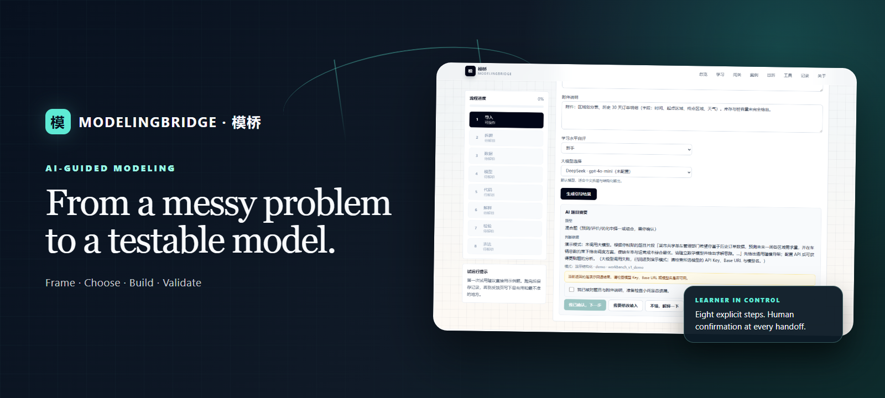
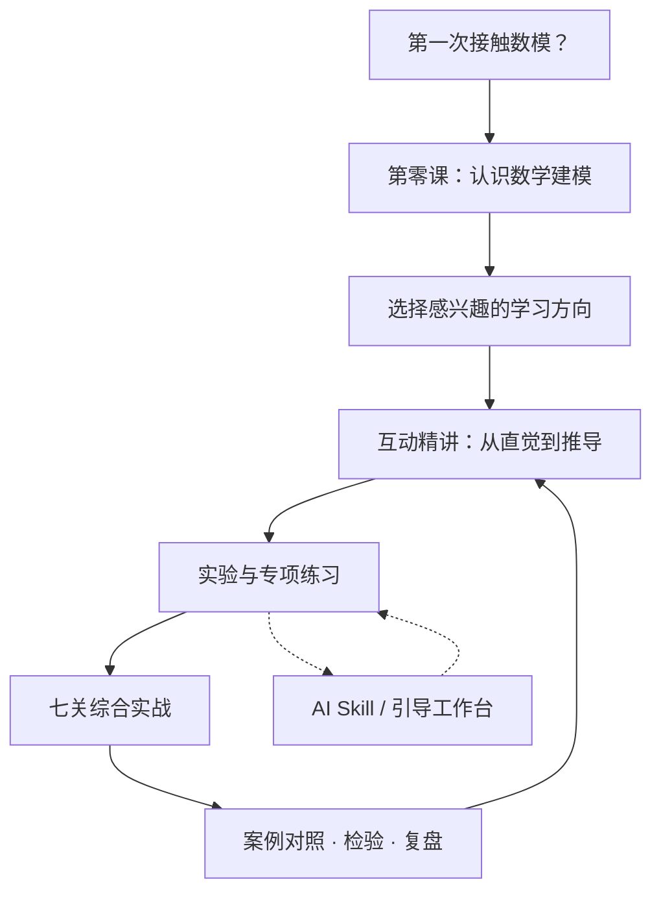
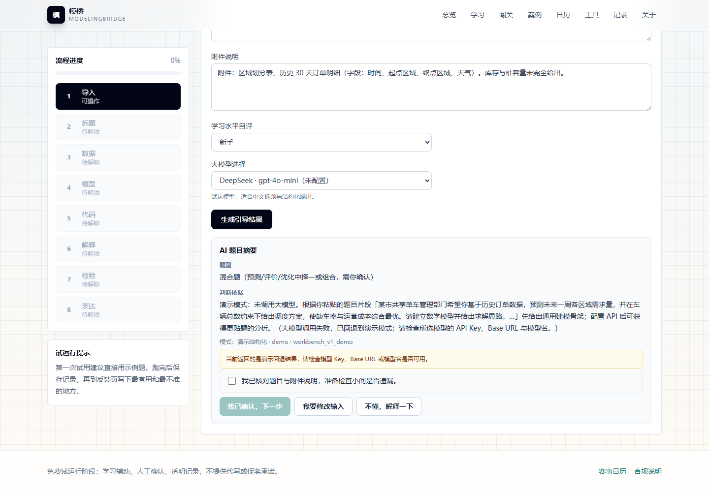
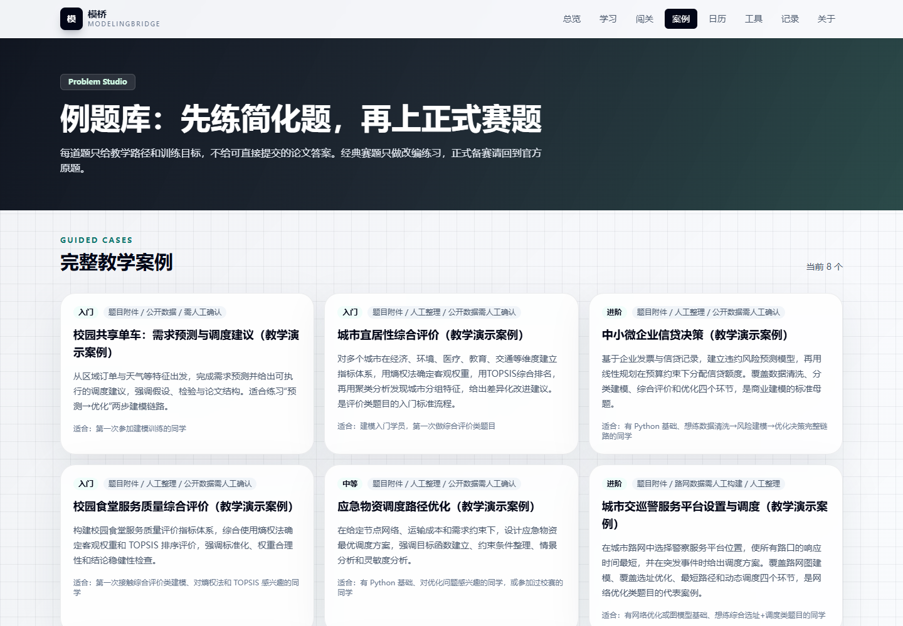
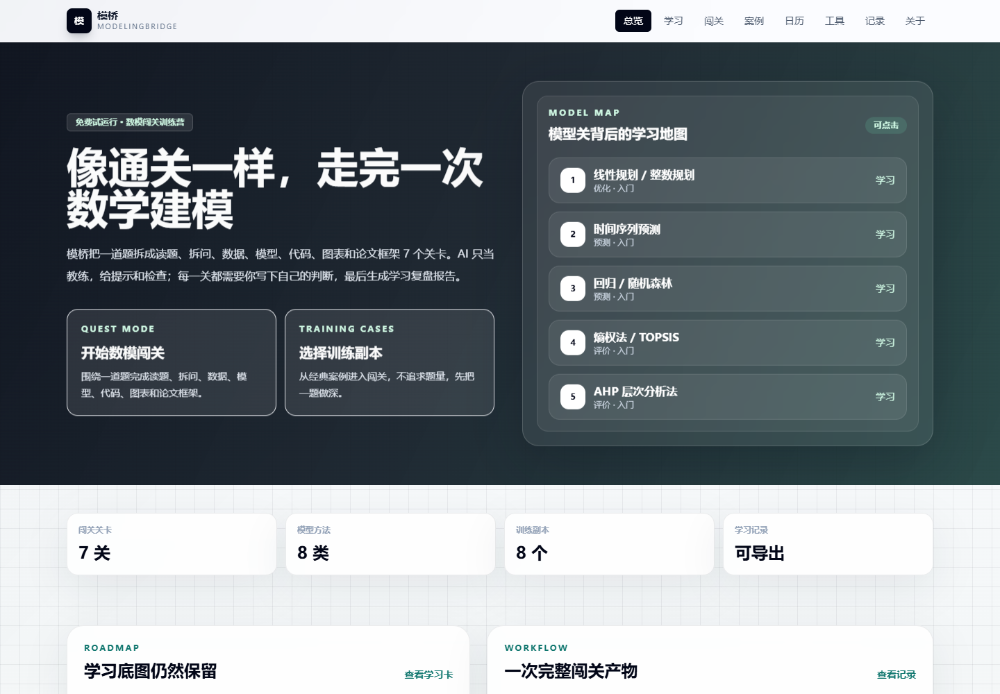
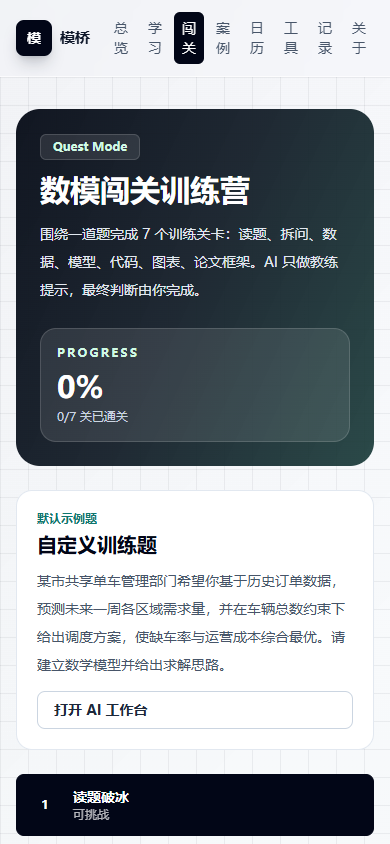
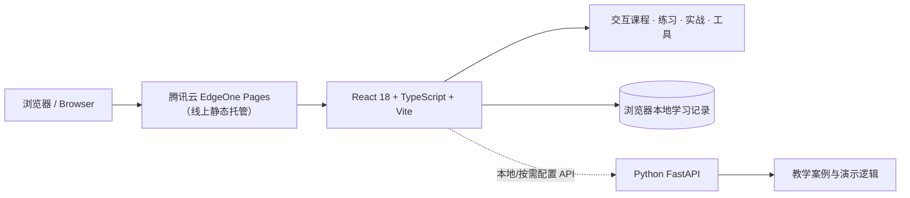

<div align="center">

# 模桥 · ModelingBridge

### 从一道看不懂的题，到一套讲得清楚的模型。
**From Confusion to Models. From Models to Solutions.**

**一个为数学建模学习者打造的交互式成长空间。**  
不只告诉你用什么模型，更陪你理解：**为什么选它、怎样求解、如何检验。**

[🌐 在线体验](https://www.modelingbridge.cc) · [📚 开始学习](https://www.modelingbridge.cc/learn) · [🧩 进入实战](https://www.modelingbridge.cc/quest) · [🌍 English](README.en.md)


**Created & Led by [@Xiaotian69](https://github.com/Xiaotian69)**

[](https://www.modelingbridge.cc)

</div>

> 📌 **这是模桥 V3.0 初期公开快照。** 本仓库完整保留 V3.0 初期版本的源代码，供展示与学习参考；其中的 AI 功能为演示模式，真实 AI 服务不包含在本次公开快照中。模桥仍在持续开发，后续版本不保证继续在此公开；想看最新进展、体验现有功能，请直接访问 **[www.modelingbridge.cc](https://www.modelingbridge.cc)**。



<sub>封面图中的界面为早期 MVP 引导工作台，并非 V3.0 当前界面。最新效果请 [打开网站](https://www.modelingbridge.cc)。</sub>

> **一句话认识模桥：** 把数学建模从“看公式、背模板、套代码”，变成一段可以探索、操作、犯错、复盘的学习旅程。

---

## ✨ 为什么做模桥？

很多人第一次接触数学建模，面对的是这样的困境：

- 题目很长，却不知道第一步该问什么；
- 听过线性规划、AHP、TOPSIS，却不知道什么时候该用；
- 代码能够运行，却说不清模型假设是否合理；
- 资料越存越多，真正练习时反而不知道从哪里开始；
- 想参加比赛，却缺少一条清晰、可以坚持的成长路线。

**模桥想做的，不是再堆一个“建模资源合集”，也不是替人生成一份现成论文。**

我们尝试把零散的知识，连接为一条完整的路径：

**理解问题 → 建立直觉 → 动手实验 → 专项练习 → 综合实战 → 复盘改进**

在这里，学习者不是答案的旁观者，而是每一步判断的参与者。

## 🚀 30 秒认识 V3.0

| 你能在模桥做什么？ | 它如何帮助你？ |
| --- | --- |
| 🎒 **从第零课入门** | 从一个下雨天的雨伞调配问题出发，亲自走一遍“目标—变量—假设—求解—检验—改进”的建模过程 |
| 📐 **学习 5 门互动精讲** | 线性规划、层次分析法（AHP）、TOPSIS / 熵权法、回归分析、图论与网络优化 |
| 🧪 **操作交互实验** | 观察变量、权重、约束或数据变化怎样影响模型结论；线性规划另有独立的交互实验室 |
| 📝 **完成专项练习** | 五门课程各有对应练习，借助分层提示与错误反馈检验理解 |
| 🧭 **挑战七关建模实战** | 从读题破冰走到论文框架，形成一条可以追溯的思路 |
| 🧠 **使用 AI Skill 与引导工作台** | 学习拆题、建模与验证的提问框架；公开快照中的 AI 工作台为教学演示模式 |
| 📅 **查阅赛事日历** | 规划报名与比赛节点，区分官方已公布、待核实与往年推算的日期 |
| 📁 **查找资料和案例** | 从原创教学内容及官方公开页面入手，不把未核验版权的文件打包分发 |
| 💾 **记录自己的学习** | 学习进度保存在当前浏览器，免注册，方便下次继续与复盘 |

> **当前状态（V3.0）：** 已部署面向学习者的静态前端体验，支持互动课程、练习、实战、案例、工具与赛事信息，目前处于免费试运行阶段。**公开版本的 AI 功能为演示模式：真实 AI 服务不包含在本次公开快照中。** 仓库后端不含调用付费模型的代码，即使配置 API Key 也只返回教学演示结果；公开快照同样不包含云端账号或自动更新赛事数据。

## 🧭 一条真正能走通的学习路线



**建议新手从这里开始：** [第零课：认识数学建模](https://www.modelingbridge.cc/learn/introduction)

### 01 · 从“我不懂数学建模”开始

第零课从一个下雨天的雨伞调配问题讲起，约 15–20 分钟。你将逐步理解：什么是目标与决策变量、为什么需要假设、模型到底在解决什么，以及答案为什么必须经过检验和改进。

无需先掌握某种编程语言或模型算法，也可以先建立建模思维。已有基础的同学可以跳过第零课，直接选择一门精讲。

### 02 · 五门课程，五种看世界的方法

| 学习主题 | 一个直观问题 | 你将接触的核心内容 | 入口 |
| --- | --- | --- | --- |
| **线性规划** | 资源有限，怎样安排才更优？ | 决策变量、目标函数、约束、可行域、最优解；附交互实验室 | [开始学习](https://www.modelingbridge.cc/learn/linear-programming) |
| **AHP 层次分析法** | 多个选择，怎样有依据地权衡？ | 层次结构、判断矩阵、权重、一致性检验 | [开始学习](https://www.modelingbridge.cc/learn/ahp) |
| **TOPSIS / 熵权法** | 一组指标，怎样把方案排出先后？ | 指标处理、理想解、贴近度、客观赋权 | [开始学习](https://www.modelingbridge.cc/learn/topsis) |
| **回归分析** | 已知一些数据，怎样预测未来？ | 最小二乘、拟合、残差、解释与预测边界 | [开始学习](https://www.modelingbridge.cc/learn/regression) |
| **图论与网络优化** | 怎样走最短路线、连接最低成本？ | 图建模、Dijkstra、Kruskal、网络优化 | [开始学习](https://www.modelingbridge.cc/learn/graph) |

课程不仅有知识讲解，还包含可操作的交互环节，让数学对象不只是静态图片和公式。五门精讲都从零讲起，不设先修课；评价类建议先学 AHP，再学 TOPSIS。

### 03 · 看懂不等于会做：练习是验证理解的地方

模桥将模型学习与专项训练连接起来：

- 题目按主题组织，五门课程各有对应练习；
- 尝试作答后查看反馈、分层提示并重练；
- 练习状态留存在浏览器本地，便于继续学习；
- 从概念判断逐渐走向实际建模问题。

**课程是为了建立理解，练习是为了发现理解的漏洞。**

[进入专项练习](https://www.modelingbridge.cc/practice)

### 04 · 七关实战：把碎片知识变成完整流程

一道数学建模题，通常没有一张“唯一正确的模型选择表”。七关训练更关注你的判断过程：

1. **读题破冰**：说清题目背景、目标、限制和关键词；
2. **拆解任务**：把大问题拆成小问，明确输入、输出和评价标准；
3. **数据侦查**：判断需要哪些数据字段、来源、单位和替代方案；
4. **模型选择**：比较基础模型和进阶模型，并说明选择理由；
5. **代码起步**：把模型路线拆成数据流、函数和伪代码；
6. **图表表达**：判断需要哪些图表，以及每张图服务哪个结论；
7. **论文框架**：整理章节、结论、检验和 AI 使用记录。

每一关都有课程预置的教练提示卡和通关条件，不调用在线 AI。**不是一键生成答案，而是学会为自己的模型负责。**

[体验七关建模](https://www.modelingbridge.cc/quest)

## 🧠 AI 在这里，应该扮演什么角色？

我们更在意一个问题：**AI 能不能帮助学生真正理解，而不是跳过理解？**

因此，模桥以可检查的推理与人工确认作为设计原则。平台中的 AI Skill 与 8 步引导工作台面向题目导入、目标拆解、数据清单、模型选择、代码实践、结果解释、检验复盘和论文表达等学习环节。

- **鼓励：** 询问思路、比较方案、生成检查清单、解释错误、帮助复盘。
- **不鼓励：** 不检查来源、不验证假设、直接把生成文本当作竞赛论文提交。
- **明确边界：** 公开快照的 AI 功能为演示模式，真实 AI 服务不包含在本次公开快照中。工作台与备赛规划接口始终返回教学演示结果，不会调用 DeepSeek 或其他收费模型，即使配置了 API Key 也一样。

> **AI 可以是副驾驶，但建模判断仍由学习者掌舵。**

## 🗂️ 不只是学模型：围绕竞赛建立学习工具箱

**教学案例。** 已有教学案例可用于对照拆题方式、建模流程和结果表达。教学案例不等同于官方竞赛标准答案。

**方法与技能。** 方法速查、AI Skill、工具箱和工作台将理论知识连接到实际任务，帮助学习者从“知道术语”走向“知道如何动手”。

**赛事日历。** 支持年度时间轴、按月列表、报名与比赛节点区分，提供来源信息及核验标记。**目前不是自动实时抓取系统**；往年推算的日期会标注“预计”，正式安排请以赛事主办方和本校通知为准。

**资料索引。** 已上线的基础模块主要提供原创课程、案例、练习和赛事官方入口，不提供文件下载。完整的教材、公开讲义、方法文献、优秀论文案例及授权资料阅读体验仍在建设中；历年赛题计划单独建设专属模块。

**招新与探索。** 网站包含独立的招新互动挑战与建模队伍分工探索，用小游戏降低“走进数学建模”的门槛。

## 🖼️ 项目预览

想看当前交互效果？**[直接打开网站](https://www.modelingbridge.cc)**。仓库目前还没有 V3.0 界面截图。

<details>
<summary>查看早期 MVP 界面截图（点击展开）</summary>

以下截图是仓库既有的历史教学演示页面，仅用于展示产品起点，**不代表 V3.0 最新生产界面**。

| 引导工作台（历史版本） | 案例库（历史版本） |
| --- | --- |
|  |  |

| 首页（历史版本） | 手机端闯关（历史版本） |
| --- | --- |
|  |  |

</details>

## 🧱 技术架构

模桥采用前后端分离的开发思路，但应当区分**正式网站已部署的静态前端**与**仓库中存在的本地后端能力**。



| 层级 | 技术与用途 |
| --- | --- |
| 前端 | React 18、TypeScript 5.6、Vite 5 |
| 样式与交互 | Tailwind CSS、响应式 UI、自定义交互组件 |
| 数学与代码展示 | KaTeX、highlight.js |
| 路由 | React Router |
| 测试 | Vitest、Testing Library、TypeScript 类型检查与构建检查 |
| 可选后端 | Python + FastAPI（教学案例与 AI 演示接口；不含真实 AI 服务） |
| 线上前端托管 | Tencent Cloud EdgeOne Pages |
| 学习记录 | 浏览器本地存储；当前不代表已实现账号云同步 |

### 项目结构

```text
modelingbridge/
├── frontend/             # React/Vite 网站：课程、练习、资料、日历与工具
├── backend/              # FastAPI API、模型接入与本地演示能力
├── cases/                # 教学案例数据
├── docs/                 # 产品、协作、部署、内容与项目资料
├── README.md             # 中文项目主页
└── README.en.md          # English project overview
```

项目持续迭代，目录以实际分支内容为准。

## ⚡ 本地快速启动

> **版本说明：** 默认分支 `main` 即 V3.0 初期公开快照。正式网站之后的版本在独立代码库中开发，线上功能可能与本仓库代码不同。

环境要求：**Node.js 22（LTS）**。前端可独立启动；只有在需要测试 FastAPI 工作流时才需 Python 3.11+。

```bash
git clone https://github.com/Xiaotian69/modelingbridge.git
cd modelingbridge

cd frontend
npm ci
npm run dev
```

打开终端提示的本地地址（通常为 `http://localhost:5173`）。

可选：如需运行仓库中的后端接口，从仓库根目录另开一个终端操作：

```bash
cd backend
python -m venv .venv

# Windows PowerShell:
# .\.venv\Scripts\Activate.ps1
# macOS / Linux:
# source .venv/bin/activate

pip install -r requirements.txt
python -m uvicorn app.main:app --reload --host 127.0.0.1 --port 8000
```

公开快照不包含真实 AI 服务，后端无需也不应配置任何模型密钥。如需调整本地配置，可把 `backend/.env.example` 复制为 `backend/.env`；**不要把任何私密密钥提交到 GitHub**，也不要放进构建后可公开读取的 `VITE_*` 变量。

### 运行测试

```bash
cd frontend
npm ci
npx tsc --noEmit
npm test
npm run build
```

后端测试需先安装 `backend/requirements-dev.txt`，再在仓库根目录运行 `python -m pytest -q`。其中资料目录相关测试依赖 Git 未跟踪的可选资料，干净克隆可能失败；应报告实际失败原因，不要上传或随意下载没有授权的文件来“让测试通过”。

## 🛣️ 路线图：模桥接下来想去哪里？

| 阶段 | 方向 | 状态 |
| --- | --- | --- |
| **V3.0** | 第零课、五门互动精讲、练习、七关实战、案例与工具、基础资料入口和赛事日历 | ✅ 已有可用实现 / 前端上线 |
| **内容建设** | 正规建模教材、公开讲义、方法文献、优秀论文与案例的来源核验、筛选和阅读体验 | 🔧 持续建设 |
| **赛事数据** | 自动发现赛事更新 + 人工审核 + 可追溯来源 | 🧭 规划中 |
| **学习连续性** | 账号体系、跨设备学习记录、云端同步 | 🧭 规划中 |
| **智能助教** | 更真实、可追溯、可核验的 AI 教学闭环 | 🧭 规划中 |
| **真题专属模块** | 在版权、来源及展示规则确认后建设历年题目专属入口 | 🧭 后续阶段 |

**路线图是方向，不是已交付功能承诺。** 这些方向将在官网持续推进，不代表会同步到本仓库；每个模块都要经过内容、数学正确性、浏览器测试、移动端体验与发布验收。

## 🤝 贡献、合作与项目原则

模桥希望成为可以不断改进的学习项目。欢迎围绕课程内容核验、练习设计、数学正确性、可访问性和文档提出建议。

- 本仓库现为 V3.0 公开快照，不再作为后续功能的开发基线。
- 欢迎通过 Issue 反馈快照中的内容错误、数学问题或使用建议；涉及后续版本的修改可能不会合并到本仓库。详见 [贡献指南](CONTRIBUTING.md)。
- 未经授权的竞赛资料、书籍、论文合集、个人数据和私有凭证不得提交到公开仓库。
- 公开仓库与内部资料库分工管理；公开可访问不代表任何第三方素材已获得再分发许可。
- AI 工具可以辅助撰写、开发和审查，但最终内容与发布由项目负责人审核。

## 👤 创建者与维护者

<table>
  <tr>
    <td><strong>Creator / Project Lead / Maintainer</strong></td>
    <td><a href="https://github.com/Xiaotian69"><strong>@Xiaotian69</strong></a></td>
  </tr>
  <tr>
    <td>职责</td>
    <td>项目定位、产品方向、架构与开发决策、内容审核、验收及发布管理</td>
  </tr>
  <tr>
    <td>AI 辅助说明</td>
    <td>部分开发、测试或文档工作可使用 Claude、Codex 等工具辅助；工具不代替项目负责人或实际人类贡献者署名</td>
  </tr>
</table>

**真实的人类协作者及其贡献应在提交记录、PR 和相应致谢中保留。** GitHub 自动统计的 Contributors 与项目创建者身份不是同一个概念。

## 📜 许可、内容与学术诚信

**公开可见 ≠ 已授予开源许可证。** 仓库目前没有适用于整个项目的正式 `LICENSE` 文件，因此在负责人明确选择并发布许可证之前，不将代码宣传为已采用 MIT 或其他开源许可。第三方内容、图片、赛事材料与论文的权利仍属于各自权利人。

模桥是教育与练习工具，不提供代写、代赛或奖项保证。课程和案例应作为学习参考；用户需独立核验数据来源、数学推导、模型假设、代码、引用与最终结论，并遵守所在学校和比赛的 AI 使用规则。

## 🌉 模桥的探索，远不止于此

你在这里看到的，是模桥最早铺下的几块桥板：V3.0 初期公开版本。

桥还在继续向前延伸。课程、练习和工具仍在打磨，学习路线也在根据学习者的反馈不断调整。这些新的进展会优先出现在官网，不一定同步到这个仓库。

如果你也相信，数学建模可以学得更清楚、更有成就感，欢迎到官网走一走，看看模桥现在走到了哪里。

<div align="center">

[](https://www.modelingbridge.cc)

**[www.modelingbridge.cc](https://www.modelingbridge.cc)** · 了解最新进展 · 体验现有功能

</div>

---

<div align="center">

### 从第一道题开始，搭起自己的建模之桥。

**Model Better. Think Deeper. Build Your Own Path.**

[🌐 访问模桥](https://www.modelingbridge.cc) · [⭐ Star 项目](https://github.com/Xiaotian69/modelingbridge) · [English README](README.en.md)

*ModelingBridge · Created & Led by [@Xiaotian69](https://github.com/Xiaotian69)*

</div>
