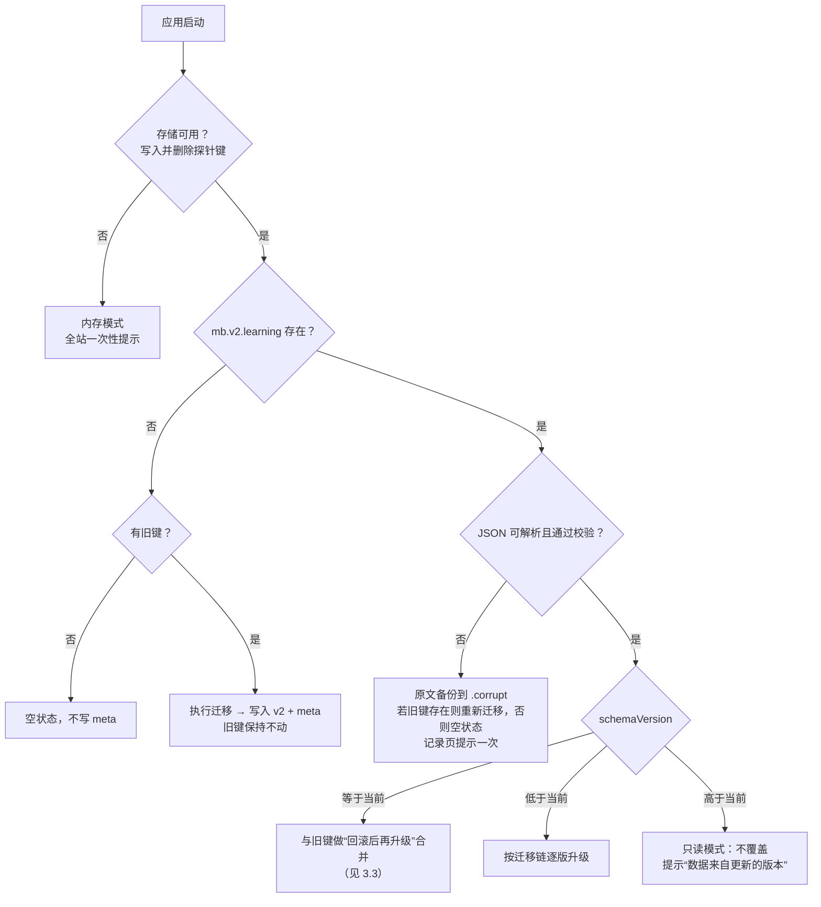

# 模桥 V2 · 旧版本地记录迁移、异常回退与兼容性测试方案

> 版本：A-2 · 2026-10-12 · 适用于阶段 B 的 `state/` 模块
> 依据：对 `feat/modelingbridge-v2-ui`（a18f357，前端与 7645dbb 相同）存储代码的逐文件审查
> 原则：**不丢数据、不复活已删除的数据、不把本地数据发往任何服务器**。

---

## 1. 旧版存储现状（实测代码）

| 存储键 | 位置 | 写入方 | 格式 | 现有校验 |
| --- | --- | --- | --- | --- |
| `mb_learning_reading_v1` | localStorage | `pages/Course.tsx`（滚动时） | JSON 字符串：小节 ID，如 `"derive"` | `readPosition` 只接受 10 个合法小节 ID |
| `mb_learning_practice_v1` | localStorage | `learning/Question.tsx`（每次有效提交） | `Record<题目ID, {correct:boolean, attempts:正整数, updated:ISO}>`，**包含内嵌题 `think-1`** | `readHistory` 逐条过滤非法项 |
| `mb_quest_draft:<sourceId>` | localStorage | `pages/Quest.tsx` | `{activeStageId, states[], checks{}, updatedAt}`；`sourceId` 为 `default` 或 `case:<slug>` | `normalizeDraft` 补齐缺失关卡；`saveQuestDraft` **写入失败会抛异常、未捕获** |
| `mb_records` | localStorage | `Records.tsx` 的 `saveWorkbenchRecord`（七关报告、工作台） | `StoredRecord[]`，最多 20 条 | 仅检查是否为数组；写入未捕获异常 |
| `mb_trial_feedback` | localStorage | `pages/Feedback.tsx` | 反馈数组，最多 50 条，**含可选联系方式** | 数组检查 |
| `modelingbridge_trial_access_code` | localStorage | `trial/access.ts` | 访问码字符串 | — |

**已发现的旧问题**（迁移设计需要兼顾，阶段 B 修复时另列）：

1. `saveQuestDraft` 和 `saveWorkbenchRecord` 在存储满或被禁用时会抛异常，可能让页面报错。
2. 记录页“清空本机记录”只清 `mb_records`，阅读位置、练习、七关草稿都还在。用户以为清空了，实际没有。
3. 内嵌检查点 `think-1` 的作答混在练习历史里。

---

## 2. V2 存储布局

| 键 | 位置 | 内容 | 是否属于“学习数据” |
| --- | --- | --- | --- |
| `mb.v2.meta` | localStorage | `{schemaVersion, migratedAt, migratedFrom[], lastWriteAppVersion}` | 内部 |
| `mb.v2.prefs` | localStorage | 主题、帮助建议开关、AI 保存偏好 | 否（偏好） |
| `mb.v2.learning` | localStorage | `LearningState`：阅读、检查点、练习（含草稿、帮助级别、尝试次数）、最近活动 | **是** |
| `mb_quest_draft:*` | localStorage | **沿用，不迁移格式** | **是** |
| `mb_records` | localStorage | **沿用，不迁移格式** | **是** |
| `mb_learning_reading_v1` / `mb_learning_practice_v1` | localStorage | 旧键保留，首个 V2 版本双写（N5） | **是** |
| `mb.v2.learning.corrupt` | localStorage | 最近一次损坏数据的原始字符串备份（仅 1 份） | **是** |
| `mb.v2.return` | sessionStorage | 回程票（1 张） | 是（会话级） |
| `mb.v2.threads` | sessionStorage（默认）/ localStorage（用户开启后） | AI 会话 | **否（AI 对话，单独管理）** |
| `mb_trial_feedback` | localStorage | 沿用 | 否（试用反馈，在反馈页管理） |
| `modelingbridge_trial_access_code` | localStorage | 沿用 | 否；**任何导出、清空都不碰它** |

七关草稿和实战报告**不复制**进 `mb.v2.learning`。学习记录页读取时直接枚举 `mb_quest_draft:` 前缀和 `mb_records`，避免同一份数据存两处后不同步。

---

## 3. 迁移规则

### 3.1 启动流程

### 3.2 字段映射（旧 → V2）

| 旧数据 | V2 位置 | 规则 |
| --- | --- | --- |
| `mb_learning_reading_v1 = "derive"` | `reading["lp"].lastSectionId = "derive"`，`visited = ["derive"]` | 非法 ID 忽略；无时间戳时 `updatedAt = migratedAt` |
| `practice["think-1"]` | `checkpoints["think-1"] = {tried:true, lastResult}` | 检查点只记“尝试过”和最近结果，不计入练习 |
| `practice["self-*" / "practice-*"]` | `exercises[id] = {attempts, lastStatus: correct?"correct":"incorrect", updatedAt: updated, helpLevelReached: 0, legacy: true}` | 旧数据没有草稿和帮助级别，`legacy:true` 表示“旧版记录、细节不全” |
| 题库中已不存在的题目 ID | `exercises[id]` 保留并标 `orphan: true` | 不删除；记录页不显示；导出包含 |
| 单条非法记录 | 丢弃，计入 `meta.droppedOnMigration` | 与现有 `readHistory` 行为一致 |
| `mb_quest_draft:*`、`mb_records` | 不迁移 | V2 继续使用现有读写函数（补上异常捕获） |

### 3.3 回滚后再升级的合并

场景：V2 上线 → 回滚到 V1，用户在 V1 继续练习 → 再次升级 V2。

- `mb.v2.meta.migratedAt` 存在，且 `mb_learning_practice_v1` 中某题的 `updated` 晚于 V2 中该题的 `updatedAt` 时：用旧键的 `attempts`、`lastStatus` 覆盖，保留 V2 独有的草稿和帮助级别。
- 阅读位置没有时间戳：V1 期间的阅读位置无法判断新旧，**以 V2 为准**。若 V2 中没有该章阅读记录，才采用旧键。

### 3.4 双写（首个 V2 版本）

- 每次 V2 写入阅读位置或提交结果时，同步写入旧键的对应格式；双写失败不影响 V2 主写入。
- 目的：若回滚部署，V1 能读到 V2 期间的进度。
- 至少在 V2 稳定一个版本后，再由负责人决定是否停止双写。**阶段 B 不删除旧键。**

### 3.5 写入策略

- 学习状态写入防抖 300ms；页面隐藏（`visibilitychange`）和 `pagehide` 时立即写入。
- 所有 `setItem` 都包在 `try/catch` 中，失败时返回结果对象，不抛异常。
- 多标签页：监听 `storage` 事件，`mb.v2.learning` 被其他标签页修改时，按记录合并（每题、每章取 `updatedAt` 较新者），再刷新界面。同一题同时在两个标签页作答时，后写者覆盖草稿，并在被覆盖的一侧提示“此题已在另一个标签页更新”。

---

## 4. 异常与回退

| 情况 | 检测方式 | 用户看到什么 | 数据处理 |
| --- | --- | --- | --- |
| localStorage 被禁用 / 访问抛 `SecurityError` | 启动探针 | 全站一次性横幅：“此浏览器当前不允许本地保存，本次学习在关闭页面后会丢失。”记录页常驻说明，导出按钮仍可用 | 内存模式；导出内存中的数据 |
| sessionStorage 不可用 | 探针 | 无打扰提示；回程条刷新后不保留 | 回程票、AI 会话放内存 |
| 存储已满（`QuotaExceededError`） | 写入异常 | “本机空间不足，较早的 AI 对话将不再保存。” | 先淘汰“已保存到此设备”的最久未用 AI 会话后重试；**绝不自动删除学习数据**；仍失败则进入内存模式并提示导出 |
| `mb.v2.learning` 损坏 | 解析或校验失败 | 记录页一次提示：“学习记录读取失败，已保留原始数据备份并从旧版记录恢复。” | 备份到 `.corrupt`，有旧键时重新迁移 |
| 单条记录非法 | 逐条校验 | 不打扰 | 丢弃，计数写入 meta |
| 数据来自更高版本（降级部署） | `schemaVersion` 大于当前 | “你的学习记录来自更新版本，当前只读显示，避免损坏。” | 只读，不写入 |
| 题目内容版本变化 | `exerciseVersion` 与题库不同 | 草稿上方：“题目在你上次作答后更新过，请核对。” | 保留草稿，不自动清除 |
| 无痕模式（关闭即清） | 无法可靠检测 | 记录页固定说明：无痕模式、清除站点数据、更换浏览器都会丢失记录 | — |

---

## 5. 清空与导出的边界

| 操作 | 删除 / 导出的键 | 不受影响 |
| --- | --- | --- |
| **清空学习数据** | `mb.v2.learning`、`mb.v2.learning.corrupt`、`mb_learning_reading_v1`、`mb_learning_practice_v1`、全部 `mb_quest_draft:*`、`mb_records`、`mb.v2.return` | AI 对话、偏好、试用反馈、访问码 |
| **清空 AI 对话** | `mb.v2.threads`（session 与 local 两处） | 全部学习数据 |
| **导出学习数据** | 上述学习数据各键，打包为 `{format:"modelingbridge-learning-export", schemaVersion, exportedAt, data:{learning, questDrafts, records}}` | 不含 AI 对话、访问码、反馈联系方式 |
| **导出 AI 对话** | `{format:"modelingbridge-assistant-export", ...}` | 不含学习数据 |
| **从导出文件恢复**（N2，待定） | 校验格式和版本 → 预览条数 → 自动先导出当前 → 替换学习数据 | AI 对话、偏好 |

> 关键点：**清空学习数据必须同时删除旧键**，否则下次启动会从旧键重新迁移，已清空的记录又会出现。

---

## 6. 兼容性测试方案

### 6.1 单元测试（vitest + jsdom，阶段 B 新增 `state/*.test.ts`）

| 编号 | 前置数据（fixture） | 操作 | 期望 |
| --- | --- | --- | --- |
| M01 | 空存储 | 启动 | 空状态；不写 `mb.v2.meta` |
| M02 | 仅 `reading_v1 = "derive"` | 启动 | `reading.lp.lastSectionId === "derive"`；旧键不变 |
| M03 | `reading_v1 = "foo"` | 启动 | 忽略；无阅读记录 |
| M04 | `practice_v1` 含 `think-1`、`self-1`、`practice-2` | 启动 | `think-1` 进检查点；其余进练习且 `legacy:true` |
| M05 | `practice_v1` 有 2 条非法（attempts=0、缺 updated） | 启动 | 丢弃 2 条，`droppedOnMigration=2` |
| M06 | `practice_v1 = "{坏 JSON"` | 启动 | 不抛异常；练习为空；旧键原样保留 |
| M07 | `practice_v1` 含不存在的 `practice-9` | 启动 | 保留为 `orphan`；记录页不显示；导出包含 |
| M08 | v2 与旧键同时存在 | 启动 | 以 v2 为准，不重复迁移 |
| M09 | v2 损坏 + 旧键存在 | 启动 | 原文进 `.corrupt`；从旧键重新迁移；提示标志置位 |
| M10 | v2 存在；旧键某题 `updated` 更新 | 启动 | 该题 attempts/status 取旧键，草稿保留（3.3） |
| M11 | `schemaVersion: 3` | 启动 + 尝试写入 | 只读模式；存储内容未改变 |
| M12 | `setItem` 抛 `QuotaExceededError` | 写入 | 先淘汰 AI 设备会话后重试；学习数据从未被删除 |
| M13 | 访问 `localStorage` 抛 `SecurityError` | 启动 | 内存模式；界面状态标志置位；不抛异常 |
| M14 | sessionStorage 不可用 | 创建回程票 | 票存在于内存；不抛异常 |
| M15 | 有学习数据 + AI 对话 | 清空学习数据 → 重启 | 学习数据和旧键均被删除，**重启后不复活**；AI 对话还在 |
| M16 | 同上 | 清空 AI 对话 | 学习数据完整 |
| M17 | 任意数据 | 导出 → 清空 → 恢复 | 恢复后与导出前逐项相等 |
| M18 | 任意数据 | 任何导出、清空 | `modelingbridge_trial_access_code`、`mb_trial_feedback` 不变，且不出现在导出文件中 |
| M19 | V2 写入一次提交 | — | 旧键 `practice_v1` 同步更新为相同 correct/attempts（双写） |
| M20 | 双写时旧键写入失败 | — | V2 主写入成功；不报错 |
| M21 | 两个“标签页”（模拟 `storage` 事件） | 分别更新不同题 | 合并后两题都在 |
| M22 | 题目 `version` 改变 | 打开有草稿的题 | 草稿保留 + 版本提示标志 |
| M23 | `prefs.theme = "purple"` | 启动 | 回退为 `system` |
| M24 | 现有 `quest/storage.test.ts`、`learning/storage.test.ts` | — | **全部继续通过**（不修改其断言） |

### 6.2 浏览器回归（gstack browse，阶段 B 交付时执行）

1. 用 `storage set` 写入一组“旧版真实数据”（阅读到 `derive`；`self-1` 正确、`practice-2` 错 2 次；一份七关草稿到第 3 关；两条 `mb_records`）。
2. 打开 V2 构建：首页“继续学习”指向第 4 节；记录页显示练习 6 题中的状态、七关 3/7、两份报告；`practice-2` 显示“旧版记录”。
3. 进入 `practice-2` 提交一次，检查 `mb_learning_practice_v1` 被同步更新。
4. 清空学习数据 → 刷新 → 记录页为空状态，首页无“继续学习”。
5. 禁用存储（页面加载前注入一个读写都抛 `SecurityError` 的 Storage 替身；也可在浏览器设置中阻止该站点数据）：站点可完整浏览和作答，横幅出现一次。
6. 回滚演练：用 V1 构建打开同一浏览器配置，进度可见（验证双写）。

### 6.3 设备与浏览器矩阵（手动抽查）

| 环境 | 重点 |
| --- | --- |
| Chrome / Edge 桌面最新版 | 全部用例 |
| Firefox 桌面 | 存储事件合并、导出下载 |
| iOS Safari（真机） | 无痕模式提示；页面隐藏时立即写入 |
| Android Chrome | 底部抽屉与键盘；存储 |
| 微信内置浏览器 | localStorage 持久性；下载导出文件是否可用（不可用时显示“复制 JSON”降级） |
| 隐私模式（各浏览器） | 内存模式提示 |

### 6.4 通过标准

- M01–M24 全部通过；现有 175 项测试不减少、不改断言（因页面结构变化需更新的 UI 测试除外，并在 PR 中逐一列出）。
- 浏览器回归 6 步有截图证据。
- 任何路径下都没有向网络发送存储内容（开发者工具网络面板 / gstack `network` 检查）。
