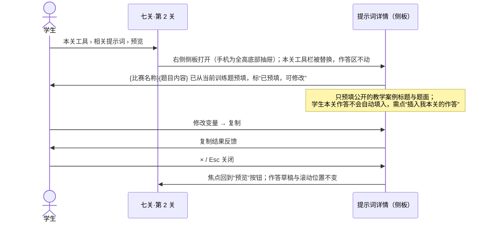

# 模桥 V2 · 六页统一导航与资料中心提示词库交互规范

> 版本：A-2 · 2026-10-12
> 内容：第 1 部分为全站导航交互；第 2 部分逐项核对旧功能入口去向，确保合并入口后没有功能丢失；第 3 部分为提示词库的完整交互。

---

## 1. 全站导航交互

### 1.1 三种顶栏

| 顶栏 | 用于 | 内容 | 行为 |
| --- | --- | --- | --- |
| **品牌顶栏** | 首页 | Logo · 4 个目的地 · 搜索 · 学习记录 · 主题 | 首屏内为深色透明；向下滚动超过首屏后变为实色（无动画；减少动态时直接切换） |
| **标准顶栏** | 精讲目录、刷题目录、实战首页、资料中心、学习记录、关于、反馈 | 同上 + 当前项下划线 | 固定在顶部，高 56px |
| **专注顶栏** | 章节阅读器、单题页、七关工作区 | Logo · 4 个目的地（视觉降权）· 面包屑 · 进度 · 主题 · ✦ 助教 | 向下滚动时只保留面包屑、进度和助教（高 48px），向上滚动恢复；键盘焦点进入顶栏时始终完整显示 |

### 1.2 当前位置规则

| 路由前缀 | 高亮项 | 面包屑示例 |
| --- | --- | --- |
| `/` | 无（Logo 即首页） | — |
| `/learn`、`/learn/*` | 精讲 | 精讲 / 线性规划 / 04 不用软件，完整求出最优解 |
| `/practice`、`/practice/*` | 刷题 | 刷题 / 线性规划 / 练习 2 of 6 |
| `/quest`、`/cases/*` | 实战 | 实战 / 资源分配训练题 / 第 2 关 |
| `/library/*` | 资料 | 资料 / 提示词库 / 赛题拆解 · 基础版 |
| `/records` | 学习记录（右侧项加粗） | 学习记录 |
| `/workbench`、`/about`、`/feedback` | 无 | 实验功能 / AI 工作台 等 |

- 面包屑每一级都可点击，最后一级是当前页（`aria-current="page"`）。
- 当前导航项使用 `aria-current="page"`，并有下划线和加粗两种视觉提示，不只靠颜色。

### 1.3 右侧工具区

| 控件 | 行为 |
| --- | --- |
| **搜索**（⌕，桌面显示 ⌘K / Ctrl K 提示） | 打开搜索浮层，焦点进入输入框。结果分组：精讲小节 · 练习 · 方法速查 · 提示词 · 资料索引。键盘：↑↓ 选择、Enter 打开、Esc 关闭并把焦点还给触发按钮。“筹备中”条目可见但不可选（`aria-disabled`）。只搜本地打包的索引，**不联网、不保存搜索词**。无结果时显示“没有找到”，并给出 4 个目的地链接 |
| **学习记录** | 进入 `/records`。有未提交草稿或进行中的七关时显示小圆点；圆点有文字替代（“有未提交的草稿”） |
| **主题** | 每次点击依次切换 跟随系统 → 浅 → 深；按钮的 `aria-label` 说明当前状态和下一个状态。偏好存 `mb.v2.prefs` |
| **✦ 助教**（仅专注顶栏） | 打开或关闭 AI 助教抽屉，详见主文档 §6.1 |

### 1.4 手机菜单

- 顶栏：Logo · 当前页简称 · 搜索 · 菜单。
- 菜单为从右侧滑入的全高面板（减少动态时直接出现），列出 **首页、精讲、刷题、实战、资料、学习记录** 6 项，当前项标“当前”；下方是主题切换，最底部列出 关于与合规 · 反馈 · 赛事日历 · GitHub。
- 焦点限制在面板内；Esc、点 ×、点遮罩、跳转页面都会关闭面板（沿用现有 `Layout.tsx` 的行为和测试），关闭后焦点回到菜单按钮。
- 屏幕宽度变为桌面时自动关闭（沿用现有行为）。

### 1.5 返回与回程

| 场景 | 行为 |
| --- | --- |
| 浏览器后退 | 始终可用，不拦截；回到上一页时恢复滚动位置（沿用现有 `RouteScroll`） |
| 回程条 | 从练习、七关、学习记录跳到精讲某一段时出现；同一时间只有一张票；点击后回到来源页并恢复状态，同时清除票据 |
| 进入单题页 | 题目导航和“← 上一题 / 下一题 →”只改变题目，不产生回程票 |
| 未知路由 | 显示 404 页（N4 待定）：说明“没有这个页面”+ 搜索框 + 4 个目的地链接 |
| 开屏（D-019） | 只在打开 / 刷新首页 `/` 时播放；站内导航回首页、前进后退、深链接、带锚点的首页、404 都不播放。详见主文档 §6.5.3 |

### 1.6 页脚

`关于与合规 · 反馈与贡献 · 赛事日历 · GitHub 开源项目 ↗`，以及一句定位语。专注页面（阅读器、单题、七关）不显示完整页脚，只在内容末尾显示一行精简页脚。

---

## 2. 旧功能入口去向（确保合并后不丢失）

> 说明：“首页起点击次数”按桌面端、从首页出发、不使用搜索计算。**所有旧路由保留或重定向。**
> 处置：保留 = 功能和位置基本不变；迁移 = 功能不变、位置变化；合并 = 与其他入口合为一处；降级 = 入口变次要；暂缓 = 入口隐藏、功能保留。

### 2.1 全局导航与页脚

| 旧入口 | 旧位置 | 新位置 | 首页起点击 | 处置 |
| --- | --- | --- | --- | --- |
| 首页 | 主导航 | Logo；手机菜单“首页” | 1 | 保留 |
| 知识库 `/learn` | 主导航 | 精讲 | 1 | 迁移（改名） |
| 竞赛资料 `/resources` | 主导航 | 资料 › 资料索引（`/resources` 重定向） | 1 | 合并 |
| 闯关训练 `/quest` | 主导航 | 实战 | 1 | 迁移（改名） |
| 工具箱 `/tools` | 主导航 | 资料 › 模板与工具（`/tools` 重定向） | 2 | 合并 |
| AI 数模助手 `/workbench` | 顶栏按钮 | 实战首页底部“AI 工作台（实验）”；资料索引中无教学案例的经典题；反馈页 | 2 | 暂缓（Q5） |
| 案例库 `/cases` | 页脚 | 实战 › 选择训练题（`/cases` → `/quest#choose`） | 1–2 | 合并 |
| 赛事日历 `/calendar` | 页脚 | 资料 › 赛事日历 + 页脚 | 2 | 迁移（Q11） |
| 学习记录 `/records` | 页脚 | 顶栏右侧 | 1 | 迁移（更显眼） |
| 项目与合规说明 `/about` | 页脚 | 页脚 | 1 | 保留 |
| 反馈与贡献 `/feedback` | 页脚 | 页脚 | 1 | 保留 |
| GitHub | 页脚 | 页脚 | 1 | 保留 |
| 跳到正文链接 | 全局 | 全局 | — | 保留 |

### 2.2 首页内容

| 旧区块 / 入口 | 新位置 | 处置 |
| --- | --- | --- |
| 首屏“开始学习” | 新手门“开始第一课” | 合并 |
| 首屏“探索知识库” | 进阶门搜索框 + 导航“精讲” | 合并 |
| 首屏快捷：数模闯关 / 历年经典题型 / AI 数模助手 | 首页文字链接“七关实战 · 资料中心 · 提示词库”；经典题型 → 资料索引；AI → Q5 | 合并 |
| 数学网络动画 | 首屏保留 | 保留 |
| 统计“8 类模型 · 7 个关卡 · ∞” | 改为“已开放 1 篇精讲 · 8 种方法速查”（不夸大） | 修改 |
| 四宫格入口（知识库、案例、七关、工具箱） | 与导航重复，移除 | 移除（功能都在导航中） |
| 学习路径卡 ×3（零基础建模 7 天 / 会 Python 10 天 / 赛前冲刺 72 小时） | 精讲目录“按目标选路线”，内容保留；只有已开放的部分可点 | 迁移 |
| 精选模型卡 ×4 | 精讲目录 › 方法索引（线性规划“可学”，其余“仅速查”） | 迁移 |
| 经典问题 ×3 | 资料索引“教学改编”+ 实战选题 | 迁移 |
| 七关横幅（7 步路线 + 本机保存说明） | 首页路线图中的“实战”+ 实战首页 | 合并 |
| 工具箱区块 | 资料 › 模板与工具 | 合并 |
| AI 助手面板（“暂未开放”状态） | 移除；AI 状态在助教抽屉中显示 | 移除 |
| 共建区块（认识模桥 / 参与共建 / GitHub） | 页脚 | 迁移 |

### 2.3 学习、速查与案例

| 旧功能 | 新位置 | 处置 |
| --- | --- | --- |
| 学习中心：线性规划介绍卡、三种模式说明 | 精讲目录顶部“新手路线”与一行模式说明 | 合并 |
| 学习中心：“模型速查与资料” | 精讲目录 › 方法索引 | 合并 |
| 速查：学习路线 tracks | 精讲目录“按目标选路线” | 迁移 |
| 速查：近三年优先训练 | 资料索引（类型“教学改编”，可筛年份）；有案例的条目可“去实战训练” | 迁移 |
| 速查：模型方法库 + 分类标签（全部 / 预测 / 优化 / 评价 / 统计 / 机理 / 网络） | 精讲目录 › 方法索引，保留分类筛选；`/learn#model-*` 锚点继续有效 | 迁移 |
| 速查：经典题改编练习 → “查看完整拆解”或“带入工作台” | 资料索引条目；“查看拆解”→ `/cases/:slug`；无案例的题保留“AI 工作台（实验）”链接 | 迁移 |
| 速查：编码 / 写作技巧面板 | 资料 › 模板与工具 | 合并 |
| 案例库：完整教学案例 ×8 | 实战 › 选择训练题 | 迁移 |
| 案例库：近三年真题拆解、经典母题 | 资料索引 | 迁移 |
| 案例库：已上传的美赛资料包 | 资料索引，`index-only`，不提供下载（Q6） | 降级 |
| 案例详情：章节锚点、“进入闯关训练”、“试用后反馈” | 保留；面包屑改为“实战” | 保留 |

### 2.4 精讲、刷题、七关

| 旧功能 | 新位置 | 处置 |
| --- | --- | --- |
| 精讲：目录、当前节高亮、手机折叠目录 | 保留，目录可收起 | 保留 |
| 精讲：“继续上次阅读” | 专题封面主按钮 + 首页“继续学习” + 记录页 | 保留并扩展 |
| 精讲：右栏“本章阅读位置 / 随时记住” | 顶栏进度条 + 右侧符号表 | 保留 |
| 精讲：节间“上一节 / 下一节” | 保留 | 保留 |
| 精讲：交互图（利润 / 资源 / 整数生产） | 保留 | 保留 |
| 精讲：公式、代码高亮、来源链接 | 保留（代码高亮改为随主题配色） | 保留 |
| 精讲：内嵌题 `think-1` | 检查点（“核对”，不计成绩） | 修改 |
| 精讲：章末“专项练习”“七关实战” | 保留；七关链接改为与本章相关的训练题 | 修改 |
| 精讲：“模型速查 ↗” | 专题封面链接到方法索引 | 迁移 |
| 刷题：模型选择、难度筛选 | 题目导航顶部 | 保留 |
| 刷题：全部题目 / 错题重练 | 题目导航“全部 \| 错题”；学习记录“只看错题 → 重练” | 保留 |
| 刷题：统计“x / 6 最近一次正确、待重练 n 题” | 题目导航底部 + 学习记录 | 保留 |
| 刷题：逐条提示 | 帮助梯子（可跳级） | 修改 |
| 刷题：提交、确定性判分、容差、多选集合判分 | 保留 | 保留 |
| 刷题：“回到精讲” | “回看知识点”（带回程票）+ 导航 | 扩展 |
| 七关：7 关、本关任务、常见错误、通关条件自检 | 保留 | 保留 |
| 七关：严格逐关解锁 | 可预览、按顺序确认完成（Q4） | 修改 |
| 七关：教练模式（提示 / 示例 / 检查） | 本关工具“教练提示”中保留三种模式 | 保留 |
| 七关：保存通关报告、重置本次闯关、查看学习记录 | 保留（重置需要确认） | 保留 |
| 七关：“打开 AI 工作台”（题面经 URL 传递） | “问 AI 助教”（演示态）；工作台链接移至实战首页底部；**不再用 URL 传题面** | 修改 |
| 七关：从案例进入（`?case=`） | 保留 | 保留 |

### 2.5 资料、工具、日历、记录、反馈

| 旧功能 | 新位置 | 处置 |
| --- | --- | --- |
| 资料：关键词检索、类型筛选 | 资料索引 | 保留 |
| 资料：类型“提示词/模板”（列出本地 Prompt 文件夹） | 提示词库（原创演示模板，不读取本地文件夹） | 修改 |
| 资料：资料夹连接状态、服务器路径 | 移除（不对学生显示服务器信息） | 移除 |
| 资料：文件下载 | 未核实授权的不提供（Q6）；原创 / 官方链接照常 | 降级 |
| 工具箱：编码技巧、写作技巧、交稿前四张检查卡 | 资料 › 模板与工具，内容全部保留 | 迁移 |
| 赛事日历：分类筛选、赛事详情、官方来源、加入规划、备赛画像、生成计划（后端或本地回退） | 资料 › 赛事日历，全部保留 | 迁移 |
| 学习记录：导出 MD / JSON、清空、复制单条、下载完整报告、复制 AI 使用记录 | 学习记录 › 实战报告（单条操作保留）；“清空”拆为学习数据 / AI 对话两类 | 保留并扩展 |
| 反馈：提交、导出 MD / JSON、清空本机反馈 | 保留在 `/feedback` | 保留 |
| 关于 / 合规说明 | 保留 | 保留 |
| 试用访问码门（`TrialGate`） | 保留，不改 | 保留 |

### 2.6 小结

- **完全移除的只有 3 项**：首页四宫格（与导航重复）、首页 AI 面板（由助教抽屉的状态替代）、资料页的服务器路径显示（不应面向学生）。
- **入口变次要的 2 项**：AI 工作台（Q5）、第三方合集下载（Q6）。
- 其余全部保留、迁移或合并，且有对应路由或重定向。

---

## 3. 资料中心 › 提示词库

### 3.1 定位与入口

- **一级导航仍叫“资料”**，提示词库是资料中心的第二个子栏（`资料索引 | 提示词库 | 模板与工具 | 赛事日历`），不新增一级导航（D-014）。
- 入口：①资料 › 提示词库；②七关各关“相关提示词”；③首页一行文字链接“提示词库”；④全站搜索结果。
- **提示词库 ≠ AI 助教**：这里只把文字复制到剪贴板，供学生在外部工具中使用，**不发起任何 AI 请求、不发送任何数据**。界面在复制按钮下方固定说明这一点。

### 3.2 URL 与状态

| URL | 含义 |
| --- | --- |
| `/library/prompts` | 列表，默认“全部用途 · 全部比赛” |
| `/library/prompts?task=读题拆解&contest=CUMCM&q=拆` | 筛选、搜索状态写在 URL 中，可分享、可后退 |
| `/library/prompts/pr.breakdown.base` | 打开某条详情：桌面为列表 + 右侧详情；手机为独立详情页 |

### 3.3 列表

- **筛选（默认只露出两项，PRD 要求“默认最少过滤项”）**
  - 用途（主筛选，单选）：全部 · 读题拆解 · 假设与变量 · 方法选择 · 数据预处理 · 代码调试 · 图表 · 摘要与论文 · 论文自检 · AI 使用说明。桌面为左侧列表，手机为横向滚动标签。
  - 比赛（下拉）：全部 · 通用 · 只列出实际收录了模板的比赛。选择某比赛时，显示“该比赛专用 + 通用”两类，通用条目标“通用”。
  - “更多筛选”默认收起：阶段（七关）、语言、适用工具。
- **搜索**：本地搜索标题、用途说明和标签，输入后 150ms 更新，匹配词高亮。
- **每一行**：标题、一句话用途、用途标签、比赛标签、`演示模板` / `原创` 徽标；操作：“预览”（打开详情）、“复制”（直接复制模板原文，提示其中有未填写的占位符）。
- **排序**：默认按七关阶段顺序，同阶段按标题。
- **状态**：
  - 空结果：“这个用途 / 比赛下还没有模板”+“查看全部”链接。
  - 内容加载失败（按需加载的代码块下载失败）：“提示词库没能打开”+ 重试。
  - 只显示 `reviewStatus = reviewed` 或明确标 `demo` 的条目；草稿模板不公开。

### 3.4 详情

自上而下：

1. **标题** + 徽标（演示模板 / 原创 / 授权状态）。
2. **元信息**：用途 · 适用阶段（如“第 1–2 关”）· 适用比赛 · 来源 · 作者 · 版本 · 更新日期 · 授权。
3. **比赛提醒**（当选择了比赛或模板带比赛标签时）：“是否允许使用 AI、如何披露，以当届官方规则为准。”有该比赛的专门说明时一并显示。
4. **使用前提**：例如“先自己读完题目再使用”。
5. **变量**：每个 `{变量}` 一个输入框，带标签、必填标记、示例占位文字。
   - “填入示例”按钮：填入示例值，输入框标“示例”，提醒替换。
   - “清空填写”按钮。
6. **预览**：完整文本，已填变量用浅底标出，未填占位符用警示色高亮；“全文 / 收起”切换（列表内预览默认 8 行）；显示字数。
7. **操作**：“复制完整提示词”（主按钮）；“查看填写示例”。
8. **适用性与限制**：AI 输出需要自行核对，尤其是模型选择、数学结论与引用；不得用于捏造数据、结果或引用。

### 3.5 复制的三种结果

| 结果 | 条件 | 反馈（`aria-live="polite"`，保留 4 秒） |
| --- | --- | --- |
| 成功 | 剪贴板写入成功且无未填变量 | ✓ “已复制完整提示词” |
| 成功但含占位符 | 写入成功但有未填变量 | “已复制。仍有 2 个占位符未填写：{比赛名称}、{我已有的思路}” |
| 失败 | 剪贴板接口不可用或被拒绝 | “复制失败”，并展开全文文本框、自动全选，提示按 Ctrl+C / 长按复制 |

复制行为不记录、不上报，不产生任何网络请求。

### 3.6 变量值的保存

- 变量值只保存在**当前浏览会话**中（按模板 ID 存 sessionStorage），离开再回来还在，关闭标签页即消失。
- 不写入学习数据、不进入导出文件。原因：学生可能粘贴整段赛题或自己的思路，没有必要长期留存。

### 3.7 从七关打开（同一个详情组件）

- 一关有多条相关模板时，侧板顶部显示“相关提示词（2）”列表，点选后进入详情，“← 返回列表”。
- 侧板底部“在资料中心打开 ↗”跳转到 `/library/prompts/:id`，并带上回程票（可回到本关）。
- 关卡与模板的对应关系由模板的 `stage` 字段决定（例如 `breakdown` → 第 2 关），七关代码不硬编码模板 ID。

### 3.8 无障碍与键盘

- 用途筛选是单选按钮组（方向键切换），比赛是原生下拉。
- 列表行是链接；“复制”是独立按钮，有完整的 `aria-label`（“复制：赛题拆解 · 基础版”）。
- 变量输入框都有可见标签；预览区不设实时播报，复制结果单独播报。
- 侧板打开时焦点进入侧板标题，Esc 关闭并还原焦点。

### 3.9 内容维护（供协作者）

- 每条模板一个 TypeScript 数据文件，放在 `content/prompts/`；字段见主文档 §8.2 `PromptTemplate`。
- 自动测试检查：ID 唯一；`templateText` 中的 `{变量}` 与 `variables` 一一对应；`licenseStatus`、`source`、`version` 必填；`stage` 取值合法；比赛标签在允许列表内。
- 阶段 B 只放 3–5 条**原创**演示模板；不导入 `资料/`、`数学建模Prompt/` 或任何第三方文本。
