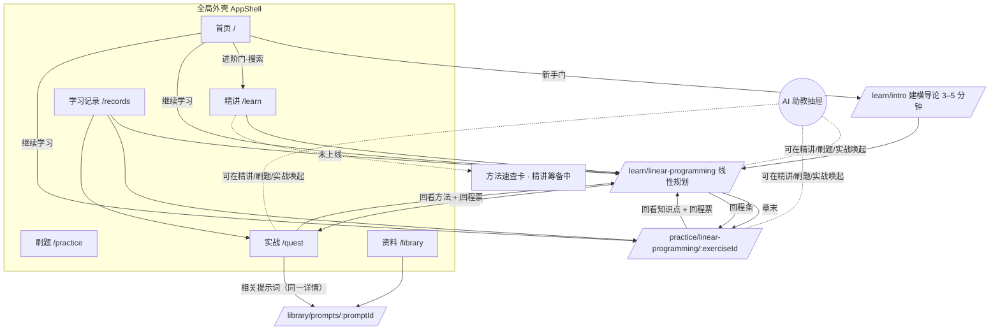
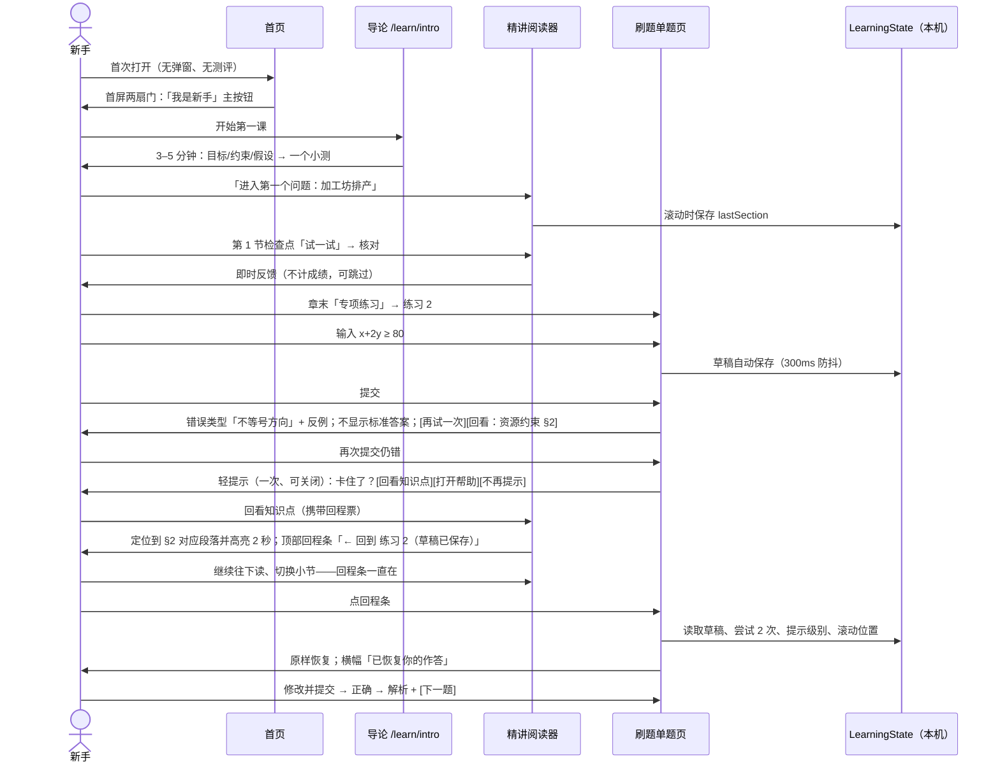
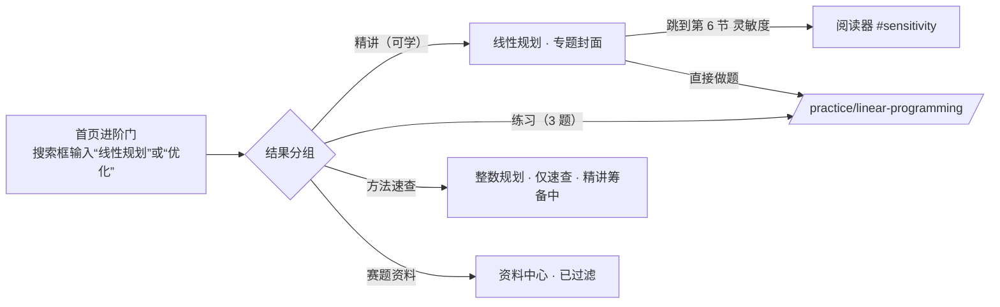
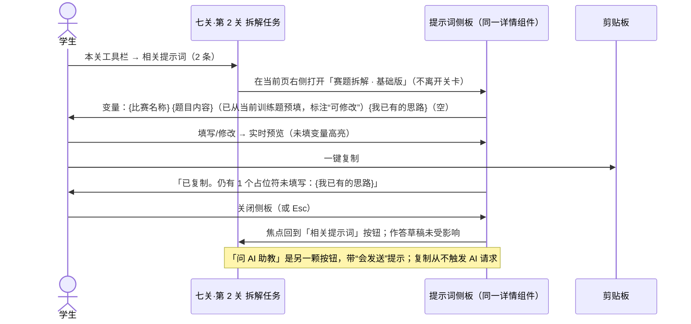
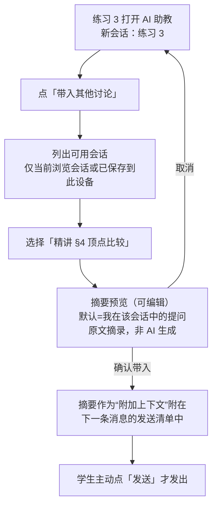
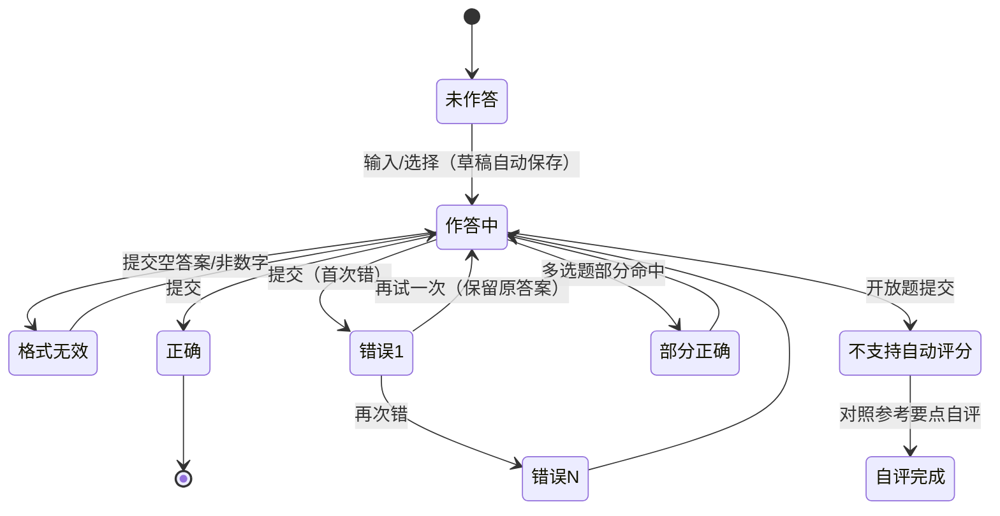

# 模桥 ModelingBridge V2.0 · 阶段 A：产品与交互设计说明

> 版本：A-3（阶段 A 最终交付 + D-019 开屏，待负责人审核）· 日期：2026-10-12 · 作者：Claude（产品交互 / 信息架构）
> 依据：`ModelingBridge_PRD_v0.13.md`、`ModelingBridge_Claude_UIUX_Framework_Brief_v1.md`、本地代码只读审查
> **本轮未修改任何业务代码，未提交、未推送、未部署。** 本目录文件为本地未跟踪文件。
>
> **交付文件（同目录 `docs/design/v2-ux/`）**
>
> | 文件 | 内容 |
> | --- | --- |
> | `ModelingBridge_V2_UX_Design_A.md`（本文件） | 主设计说明 |
> | [`wireframes.html`](wireframes.html) | 可交互低保真线框（页面、桌面/手机、浅/深、交互状态、“显示可点区域”） |
> | [`01_待决问题与决定_Q1-Q12.md`](01_待决问题与决定_Q1-Q12.md) | 12 个问题的决定 / 推荐与理由 + 新发现的 N1–N5 |
> | [`02_本地记录迁移与兼容测试方案.md`](02_本地记录迁移与兼容测试方案.md) | 旧存储迁移、异常回退、清空导出边界、24 项单测 + 浏览器回归 |
> | [`03_统一导航与提示词库交互.md`](03_统一导航与提示词库交互.md) | 导航交互、旧功能入口去向表、提示词库完整交互 |
> | [`04_线框交互核查报告.md`](04_线框交互核查报告.md) | 45 项自动化核查结果；线框可点 / 演示态 / 旧项目已实现 对照 |
>
> **A-3 变更（D-019）**：新增 §6.5 开屏动画（自动播放、可跳过、仅首页首次加载）；线框首页加入可播放、可逐帧查看的开屏原型；验收与阶段 B 拆分相应补充。
>
> **A-2 变更**：并入负责人已定的 Q1、Q4、Q6、Q7，以及已认可方向的 Q2、Q3；题目与小节 ID 改为沿用现有命名（N1）；七关草稿与实战报告不再复制进 `LearningState`。

---

## 0. 一页结论

### 0.1 我确认的代码现状

- 审查基线：本地 `feat/modelingbridge-v2-ui` = `7645dbb`；远程同名分支已到 `a18f357`（PR #3 协作文档），两者**前端代码完全一致**，差异只在 `.github/`、README、CONTRIBUTING、docs。阶段 B 应以 `origin/feat/modelingbridge-v2-ui`（a18f357）为基线。
- 质量基线：`tsc --noEmit` 通过；`vitest` 26 个文件 / 175 项测试全部通过（2026-10-12 本机运行）。
- 已真实可用：线性规划十节连续教材（KaTeX、可调参数可行域图、Python 代码、117 组 HiGHS 独立核验）、7 道已核验客观题与确定性判分、阅读位置本机保存、七关训练（本机草稿、逐关解锁、报告导出）、8 个静态教学案例、模型速查、赛事日历（带本地回退）、首页数学网络动效、移动导航与减少动态效果。
- 依赖后端、静态部署下不可用：资料下载、AI 工作台、赛事计划生成（有本地回退）。

### 0.2 核心问题（一句话版）

**内容已经有了“一本好教材”的雏形，但外面套着一个“功能导航站”的壳。** 同一件事有 3–5 个名字、3–4 个入口；三套样式系统让各页像不同网站；精讲、刷题、实战之间没有回路（答错后回不到知识点，回来也恢复不了草稿）；最显眼的按钮（“AI 数模助手”）通向一个未开放的服务。

### 0.3 删繁就简的总思路

1. **一级导航只表达“学习动作”**：精讲 · 刷题 · 实战 · 资料（+ 右侧“学习记录”与主题切换）。首页 = Logo。AI 不再占导航位。
2. **首页 9 段 → 3 段**：双入口首屏 → 继续学习（仅有记录时出现）→ 一张学习路线图。四宫格入口、三张路径卡、模型卡、案例列表、七关横幅、工具箱、AI 面板全部移除或下沉到对应页面。
3. **合并重复页面**：`/learn` 学习中心 + `/learn/reference` 速查 → “精讲”目录；`/cases` → 实战选题；`/tools` + `/calendar` → 资料中心子栏；`/workbench` 从导航与首页撤下，保留路由并标注“实验”。
4. **一条贯穿三页的“回程”机制**：从任何题目/关卡跳去看知识点，页面上始终有一条“← 回到 练习 2（草稿已保存）”，点一下就回到原题原状态。
5. **一把帮助梯子，两种来源**：刷题和检查点的“启发 / 线索 / 完整解析”三级，与 AI 助教的三级帮助合并成同一个梯子；每一级先展示课程预置（已核验）内容，再提供“请 AI 针对我的作答解释”的显式发送按钮。避免学生面对两套看起来相似的三级帮助。

### 0.4 请优先评审的三处交互

| # | 交互 | 为什么最需要你拍板 | 线框位置 |
| --- | --- | --- | --- |
| ① | **回程条 + 草稿恢复**（练习 → 知识点 → 回到原题） | 这是 PRD 首个纵向切片的验收核心，也决定 `LearningState` 与路由设计 | 线框 › 刷题 › “答错 2 次” → 点“回看知识点” → 精讲页顶部回程条 |
| ② | **一把梯子两种来源**（静态提示与 AI 三级帮助合并） | 这是我对 PRD 的主动改动：D-012 的“分层提示”与 D-016 的“AI 三级帮助”在 UI 上合为一个控件 | 线框 › 刷题 › 帮助面板 / AI 抽屉 |
| ③ | **首页双入口形态**：新手门直接进入第一课；进阶门是“内嵌搜索框”而不是按钮 | 决定首页首屏层级和移动端首屏 | 线框 › 首页 |

---

## 1. 现状盘点

### 1.1 三栏总表

| 模块 | 当前已实现 | 存在问题 | PRD 计划中但未实现 |
| --- | --- | --- | --- |
| 全局导航 `layouts/Layout.tsx` | 5 项主导航 + AI 按钮 + 页脚 5 链接；移动折叠菜单、Esc 关闭、跳到正文 | 导航名“知识库”而页面叫“学习中心”；“闯关训练/数模七关/七关实战/数模闯关训练营/Quest Mode”五种叫法；**最高视觉权重的“AI 数模助手”通向未开放服务**；学习记录藏在页脚 | 六个稳定目的地；深浅主题切换；全站搜索 |
| 首页 `pages/Home.tsx` | 数学网络首屏 + 9 个区块，动效完整且降级良好 | 无“新手/进阶”双入口；两个主按钮都去 `/learn`；3 张学习路径卡都链到同一页；4 张模型卡中 3 张只是速查却写“理解这个模型”；“8 类模型方法 · ∞ 种可能”夸大可学内容；四宫格入口重复导航 | D-006 双入口；继续学习；未上线内容明确标记 |
| 学习中心 `pages/Learn.tsx` | 线性规划精讲入口 + 三种模式说明 + 速查入口 | 与首页、速查页重复介绍；“三种模式”是功能说明而非学习路径 | 按方法查找；专题页（适用场景/先修/精讲/练习/赛题） |
| 精讲 `pages/Course.tsx` + `learning/*` | 十节连续正文、左目录、右侧“本章阅读位置/随时记住”、KaTeX、代码高亮、交互图、内嵌题、续读链接、手机折叠目录 | 内嵌检查点与正式题用同一组件和“提交答案”文案，并写入练习历史（不应计成绩）；章末“进入七关实战”打开的是共享单车默认题，与本章无关；没有 AI 入口、没有“回到原题” | AI 抽屉；选中解释；关联知识点；回程；N0 导论 |
| 专项刷题 `pages/Practice.tsx` | 6 题列表、难度筛选、错题重练、提示逐条展开、确定性判分、本机作答历史 | **首次答错即显示标准答案**（违背 D-012/D-016 “不默认泄露”）；手机上第一道题在一整屏筛选器之后；所有题一次铺开，无单题焦点；草稿不保存（离开即丢）；错因不链接知识点；`knowledge` 是自由文本，没有稳定锚点 | 错因 → 知识点锚点 → 返回原题；草稿/提示级别/尝试恢复；轻主动帮助；AI 三级 |
| 七关实战 `pages/Quest.tsx` | 7 关、本机草稿、通关条件自检、教练提示卡、报告保存/导出、案例种子 | Tailwind 深色横幅 + 圆角卡片，与精讲页像两个网站；严格顺序锁关；“打开 AI 工作台”把最多 1500 字题面放进 URL 查询参数 | 关卡内“相关提示词”；与 AI 助教区分；学习记录统一 |
| AI 工作台 `pages/Workbench.tsx` | 8 步 AI 引导分析（依赖 FastAPI + LLM），多提供商 | 与七关是**两条平行的 7/8 步流程**；静态站不可用；题面经 URL 传入 | D-015/016/017 的上下文助教（应取代它的入口地位） |
| 资料 `pages/Resources.tsx` + `backend/routers/resources.py` | 后端扫描本地文件夹并提供下载；访问码保护 | 静态部署下必然报错；资料源为第三方公众号合集，**无授权状态字段**；界面显示服务器本地路径；访问码作为 URL 参数传递 | 资料索引 + 授权状态；提示词库（二级）；模板与工具 |
| 案例 `pages/Cases.tsx` / `CaseDetail.tsx` | 8 个静态案例 + 近三年真题拆解 + 美赛资料包 + 经典母题 | 与首页“PROBLEMS & CASES”、速查页“近三年优先训练/经典题改编练习”**三处重复** | 作为实战题源 |
| 工具箱 / 赛事日历 / 关于 / 反馈 | 指南、四张检查卡；日历 + 备赛画像（本地回退）；合规说明；本机反馈表 | 工具箱与首页工具段重复；日历在页脚，存在感弱但内容扎实 | 归入资料中心 |
| 学习记录 `pages/Records.tsx` | 显示七关/工作台保存的报告，导出 MD/JSON，清空 | **看不到精讲进度和刷题记录**；5 个存储键各自为政（`mb_learning_reading_v1`、`mb_learning_practice_v1`、`mb_quest_draft:*`、`mb_records`、`mb_trial_feedback`），“清空”只清其中一个 | 统一进度/错题/草稿；学习数据与 AI 历史分开导出/清空；AI 本机保存开关 |
| 样式系统 | `index.css`（首页/布局，含 token）、`learning.css`（局部覆写 token）、Tailwind 工具类（实战/资料/记录/案例/日历/工具） | 三套并存；无深色模式；同一“次要按钮”有至少 4 种外观 | 统一 token、深浅主题、组件状态规范 |
| 试用门 `trial/*` | 环境变量访问码 | `VITE_` 变量会进浏览器包，属于“轻保护”，文档已说明 | — |

### 1.2 与 PRD 的数据差异（需确认）

- PRD §12.1 的样板例题为 `max 30x+20y, x+y≤8, 2x+y≤10`（最优 (2,6)，Z=180）；**代码实际上线的是 `max 40x+50y, 2x+y≤100, x+2y≤80`（最优 (40,20)，Z=2600），并已完成 HiGHS 独立核验与十节正文**。PRD §14.2 的 `x+y≤8` 练习在题库中不存在。
- **已定（Q1）**：以已核验的代码例题为准，统一 PRD、教材与练习，保留数学验证；§14.2 的“约束方向”练习改写到同一工坊情境（`x+2y≤80`，错答 `≥` 时用 `(0,50)` 用掉 100 小时装配作反例），作为拟新增题 `practice-4`，上线前需核验。线框即按此绘制。

---

## 2. 旧功能处置清单（保留 / 整合 / 移除 / 暂缓）

> 原则：**不删除可用能力与数据**。“移除”仅指从导航/首页撤下入口；路由、组件、存储键在阶段 B 中保留或重定向。

| 现有功能 | 处置 | 去向 / 做法 | 用户价值 | 代码风险 |
| --- | --- | --- | --- | --- |
| 首页数学网络 `MathNetwork` | **保留** | 只在首页首屏；手机降为静态 SVG 或 ≤24 节点 | 品牌科技感 | 低（已有测试） |
| 首页四宫格入口、三张路径卡、模型卡、案例列表、七关横幅、工具箱、AI 面板、共建段 | **移除（首页）** | 被“双入口 + 继续学习 + 路线图”取代；共建链接进页脚 | 降噪，首屏决策从 10+ 个降到 2 个 | 低；`Home.test.tsx` 需重写 |
| `/learn` 学习中心 | **整合** | 成为“精讲”目录页：上半“新手路线”，下半“按方法查找” | 一个入口两种找法 | 中：锚点重定向需保留 |
| `/learn/reference` 模型速查 | **整合** | 并入精讲目录的“方法索引”，未有精讲的方法显示“仅速查 · 精讲筹备中” | 进阶用户直达 | 中：旧锚点 `#model-*` 重定向保留 |
| `/learn/linear-programming` 精讲 | **保留并精修** | 新阅读器外壳；顶部加“专题封面” | 首个纵向切片 | 中：保留 `content.ts` 结构与阅读键 |
| `Graph` 可行域交互 | **保留** | 作为“可视化容器”首个实例；补深色配色 | 核心教学价值 | 低 |
| `Question` 组件 | **拆分** | `Checkpoint`（即时核对、不计成绩）与 `ExerciseCard`（提交后反馈）共用 `grading.ts` | 两种反馈节奏（D-012） | 中：有组件测试 |
| `/practice/linear-programming` | **重构** | 单题焦点 + 题目导航 + 帮助梯子；保留难度/错题筛选 | 刷题闭环 | 中：`PRACTICE_KEY` 迁移 |
| `/quest` 七关 | **保留逻辑，迁移外观** | 新工作区布局；加“相关提示词”；可预览后续关卡、按顺序确认完成（Q4 已定） | 实战 | 中：数据格式与存储键不变 |
| `/workbench` AI 工作台 | **暂缓（撤下入口）** | 路由保留，实战页底部“实验功能”链接；将来其分析能力拆入 AI 助教 | 避免两条平行流程 | 低（不改代码，只撤入口） |
| `/cases`、`/cases/:slug` | **整合** | 实战页“选择训练题”；详情页面包屑归入实战 | 题源与实战连在一起 | 低 |
| 近三年真题、经典母题列表 | **整合** | 资料中心 › 资料索引（带来源与授权标签），可“去实战” | 消除三处重复 | 低 |
| `/resources` 下载 | **重构 + 下载暂缓** | 资料中心 › 资料索引；默认“仅索引/官方链接”，授权核验前不提供第三方文件下载 | 合规 | 低（前端隐藏，后端不动） |
| `/tools` | **整合** | 资料中心 › 模板与工具 | — | 低 |
| `/calendar` | **整合** | 资料中心 › 赛事日历 | — | 低 |
| `/records` | **重构** | 统一学习记录（见 §5.6） | 可追踪、可控 | 中：多键迁移 |
| `/about`、`/feedback` | **保留** | 页脚 | — | 无 |
| `TrialGate` | **保留** | 不改 | — | 无 |
| `backend/prompts/library/*` | **保留，不混用** | 这是后端系统提示，**不是**学生用提示词库 | — | 无 |

---

## 3. 信息架构

### 3.1 导航地图



### 3.2 一级导航与命名统一

> 顶栏、面包屑、搜索、手机菜单的完整交互，以及每个旧入口的新去向，见 [03 文档](03_统一导航与提示词库交互.md)。

| 位置 | 桌面 | 手机 |
| --- | --- | --- |
| 左 | Logo（= 首页） | Logo |
| 中 | **精讲 · 刷题 · 实战 · 资料** | — |
| 右 | 搜索 ⌘K · **学习记录**（有未完成草稿时显示小圆点）· 主题（系统/浅/深） | 搜索 · 菜单（含 4 项 + 学习记录 + 主题） |

- 我**不建议**手机用底部 Tab 栏：刷题和实战需要把屏幕底部留给“提交 / 帮助”操作栏和 AI 底部抽屉，底部 Tab 会形成三层堆叠。
- 统一叫法（全站文案、面包屑、标题一致）：

| 旧叫法 | 统一为 |
| --- | --- |
| 知识库 / 学习中心 / 模型速查 | **精讲**（目录页叫“精讲目录”，速查卡叫“方法速查”） |
| 专项训练 / 刷题模式 / 题库 | **刷题** |
| 闯关训练 / 数模七关 / 七关实战 / 数模闯关训练营 / Quest Mode | **七关实战**（导航简称“实战”） |
| 竞赛资料 / 资源窗口 / Resource Vault / 工具箱 | **资料中心**（导航简称“资料”） |
| AI 数模助手 / AI 工作台 / AI 引导工作台 / AI 教练 | **AI 助教**（上下文能力）；旧工作台称“AI 工作台（实验）” |

### 3.3 路由表（阶段 B 草案，旧链接全部保留可达）

| 路由 | 页面 | 备注 |
| --- | --- | --- |
| `/` | 首页 | |
| `/learn` | 精讲目录（新手路线 + 方法索引） | 旧 `/learn#model-*` → 速查卡锚点 |
| `/learn/intro` | N0 建模导论（短页） | 阶段 B 为结构 + 标注“内容草稿” |
| `/learn/:topic` | 专题封面 + 章节阅读器 | `#section-id` 定位；`/learn/reference` → `/learn#methods` |
| `/practice` | 刷题目录（按专题、错题） | |
| `/practice/:topic` | 题组，默认打开第一道未完成题 | 兼容现有链接 |
| `/practice/:topic/:exerciseId` | 单题焦点 | **回程票的落点必须可深链** |
| `/quest`、`/quest?case=&stage=` | 七关工作区 | 保留 `case` 参数，新增 `stage` |
| `/cases/:slug` | 训练题详情（面包屑：实战） | `/cases` → `/quest#choose` |
| `/library`、`/library/prompts`、`/library/prompts/:promptId`、`/library/tools`、`/library/calendar` | 资料中心与子栏 | `/resources`→`/library`；`/tools`、`/calendar` 重定向 |
| `/records` | 学习记录 | 保留 |
| `/workbench`、`/about`、`/feedback` | 保留，不在主导航 | |

### 3.4 “专题”放在哪里

PRD 要求“线性规划只有一个模型专题页”。我**不新增独立的专题页面**，而是把它做成阅读器顶部的**专题封面**：标题、你将学会、先修（可跳过）、四个出口——“从头读 / 继续第 N 节”“专项练习 3 题”“竞赛应用 → 七关实战”“进阶拓展（筹备中）”。滚过封面即进入第 1 节正文。少一层页面，进阶用户从搜索进来也只需一屏就能决定去哪。

---

## 4. 关键用户旅程

### 4.1 旅程一：新手初访 → 精讲 → 检查点 → 练习 → 答错 → 回看知识点 → 恢复原题



关键规则：

1. 回程票 `ReturnTicket` 同时写入路由 state 与 `sessionStorage`：刷新阅读器后回程条仍在；关闭标签页后消失（草稿本身仍在 `localStorage`）。
2. 回程条只保留**一张**票（最近一次来源），避免“回程栈”让学生迷路；浏览器后退照常可用。
3. 点击回程条或在原题页手动返回，都会消费并清除该票。

### 4.2 旅程二：进阶用户搜索模型 → 直接阅读或刷题



- 搜索为**前端本地索引**（专题、小节标题、知识点、题目、提示词、资料条目），不需要后端；⌘K / 顶栏搜索与首页进阶门共用一个组件。
- 搜索结果对未上线内容只显示“筹备中”，**不可点击进入空页面**。
- 进阶用户不被要求读导论；封面“先修”只是可折叠的建议。

### 4.3 旅程三：七关实战 → 使用相关提示词 → 复制 → 回到原关卡



- 侧板底部有“在资料中心打开”，深链 `/library/prompts/pr.breakdown.base`，用于收藏/分享。
- 手机端侧板变为底部抽屉（全高），关闭后回到关卡同一滚动位置。

### 4.4 补充旅程：跨章节续聊（D-017）



说明：AI 未接入期间，摘要用**确定性摘录**（我在该会话中的问题列表 + 字数上限），明确标“非 AI 生成”；将来接入后可选“让 AI 生成摘要”，并标注“AI 生成，可能遗漏”。

---

## 5. 页面设计

> 每个页面给出：目标 → 结构（桌面 / 手机）→ 关键状态 → 行为规则。可交互版本见 `wireframes.html`。

### 5.1 首页（品牌层，唯一允许氛围动效的页面）

**目标**：3 秒内让人知道“从哪开始”；再来的人一键继续。

```
桌面 ≥1024
┌──────────────────────────────────────────────────────────────────────┐
│ [M]模桥        精讲  刷题  实战  资料             ⌕   学习记录•   ◐ │  深色、透明
├──────────────────────────────────────────────────────────────────────┤
│  从一个真实问题开始，                          ·  ·  ·  ·             │
│  学会数学建模。                              ·  数学网络（克制）  ·    │
│  免费 · 无需注册 · 本机保存进度                 ·  ·  ·  ·             │
│ ┌────────────────────────────┐ ┌───────────────────────────────────┐ │
│ │ 我是新手                    │ │ 我有基础                           │ │
│ │ 从一个真实小问题开始         │ │ ⌕ 搜索方法、题型或赛题…            │ │
│ │ 5 分钟认识建模 → 帮加工坊    │ │ 优化 · 预测 · 评价 · 统计 · 赛题    │ │
│ │ 排一周生产 → 学会线性规划    │ │ 已开放 1 篇精讲 · 8 种方法速查       │ │
│ │ [ 开始第一课 → ]（主按钮）   │ │                                     │ │
│ └────────────────────────────┘ └───────────────────────────────────┘ │
├──────────────────────────────────────────────────────────────────────┤ 浅色
│ 继续学习  线性规划 · 第 4 节 完整求出最优解 · 2 天前   [继续阅读]       │ 仅有记录时
│           练习 2 有未提交草稿                          [回到练习]       │
├──────────────────────────────────────────────────────────────────────┤
│ 一条路线，三种练法                                                     │
│  ● 认识建模 ──● 线性规划 ──○ 回归预测 ──○ 评价决策 ──○ 综合项目        │
│   5 分钟       精讲·刷题·实战   筹备中       筹备中       筹备中          │
│  精讲=读懂  刷题=检验  实战=走完一次七关                                │
├──────────────────────────────────────────────────────────────────────┤
│ 也可以直接去：七关实战 · 资料中心 · 提示词库（一行文字链接，非卡片）      │
│ 页脚：关于与合规 · 反馈 · 赛事日历 · GitHub                              │
└──────────────────────────────────────────────────────────────────────┘
```

手机：标题 → 新手门（全宽主按钮）→ 进阶门（搜索框）→ 继续学习 → 路线（竖排）。网络动画降为静态图并放在标题背后，首屏无需滚动即可看到两扇门。

规则：

- 新手门的视觉权重 > 进阶门（填充 vs 描边），但两者同一行、同等可见（D-001“新手优先、兼顾进阶”）。
- 进阶门是**可直接输入的搜索框**，输入即在门下方展开结果浮层；按 Enter 进入精讲目录并带上查询词。比“按钮 → 新页 → 再搜”少一步。
- 路线图中“筹备中”节点灰显、不可点，悬停/聚焦显示“预计内容，尚未开放”。
- **开屏（D-019）**：打开或刷新首页时自动播放约 1.5–2 秒的粒子汇聚开屏，播完自动进入，可点击跳过；站内导航与深链接不播放。完整规范见 §6.5。
- 动效：开屏之外仅首屏网络；`prefers-reduced-motion` 或手机时为静态；页面其余部分无滚动渐显（首页现有 `Reveal` 可保留但缩短为 1 次、≤200ms）。

### 5.2 模型精讲（专注层 · 重点精修）

**目标**：像一本书一样读下去；需要互动时互动，需要帮助时帮助，不被打断。

```
桌面 ≥1280（三栏仅在宽屏出现）
┌───────────────────────────────────────────────────────────────────────────┐
│ [M] 精讲 / 线性规划 / 04 完整求出最优解      ▓▓▓▓░░░░ 4/10   ☰目录 ◐ ✦助教 │ 紧凑顶栏 56px
├───────────────────────────────────────────────────────────────────────────┤
│ ← 回到 练习 2（草稿已保存）                                         ×      │ 回程条（仅有票时）
├──────────┬────────────────────────────────────────────┬───────────────────┤
│ 本章目录  │  04 / 联立方程只是一步                      │ 符号表（页边注）    │
│ 01 问题   │  不用软件，完整求出最优解                    │ x  A 产量 m²       │
│ 02 变量   │                                            │ y  B 产量 m²       │
│ 03 图解   │  正文 17px / 行高 1.85 / 每行 ≤ 38 字        │ z  贡献利润 元     │
│ ●04 推导  │  ┌ 公式 ───────────────────────[解释此公式]┐ │                   │
│ 05 Python │  │ 2x+y=100, x+2y=80 ⇒ (40,20)            │ │ 本节关联           │
│ …        │  └──────────────────────────────────────────┘ │ · 顶点最优性       │
│          │  ▏试一试（检查点）                            │ · 资源约束 §2      │
│ ◀ 收起    │  ▏(40,20) 时两种资源剩余多少？  [核对] 跳过 ↓   │                   │
│          │  表 2 · 所有顶点比较                           │                   │
│          │  ← 上一节                      下一节 →        │                   │
└──────────┴────────────────────────────────────────────┴───────────────────┘
打开 AI 助教时：右侧页边注被 400px 抽屉替换（推开而非覆盖），正文仍 ≥ 600px。
1024–1279：目录变为左侧浮层（☰ 打开），页边注移入正文内可折叠框。
手机：单列；顶栏下方「本章目录 4/10 ▾」打开全高目录抽屉；AI 为底部抽屉。
```

关键元素与规则：

- **专题封面**（见 §3.4）在章首，回访时封面中“继续第 N 节”为主按钮。
- **正文不卡片化**：段落、公式、表格、代码按版式排布；只有“交互图”“检查点”“代码实验”有容器。检查点用**左侧竖线 + 浅底**，不用阴影卡片。
- **检查点 `Checkpoint`**：按钮文案“核对”（非“提交”），即时反馈，答错给解释并可再试；**不计入练习成绩**，只记录“尝试过”；随时“跳过 ↓”。
- **选中解释**：在正文中选中文字后出现小浮钮“解释所选”；公式/代码块常驻“解释此公式/解释此代码”图标按钮（键盘可达、手机可点）。点击**只打开 AI 抽屉并把所选内容放入“将发送”清单**，不自动发送。
- **阅读进度**：顶栏细进度条 = 当前小节 / 总节数（明确是“位置”而非“掌握度”）。
- **章末**：小结 → “专项练习 3 题”（主）→ “竞赛应用：用七关实战做一道资源分配题”（链接到与本章相关的训练题，而非默认共享单车题；无相关题时显示“相关实战题筹备中”）。
- **关联知识点**：页边注“本节关联”列出 `KnowledgePoint`，点击跳到定义所在段落（同章内锚点）。

状态：正常阅读 / 带回程条 / 段落高亮（从错题跳入，2 秒淡出，减少动态时为静态描边 6 秒）/ 选中浮钮 / AI 抽屉开 / 公式渲染失败（显示 LaTeX 原文 + “公式渲染失败”）/ 交互图加载失败（显示静态表 2 替代）/ 本机保存不可用（一次性提示，阅读不受影响）。

### 5.3 专项刷题（专注层 · 重点精修）

**目标**：一次只想一道题；先自己想，再按需求助；错了知道错在哪、去哪补、怎么回来。

```
桌面
┌───────────────────────────────────────────────────────────────────────────┐
│ [M] 刷题 / 线性规划 / 练习 2 of 6                              ◐  ✦助教   │
├───────────┬───────────────────────────────────────────────┬───────────────┤
│ 题目      │ 基础 · 约束建模 · 单选                           │（助教抽屉位）  │
│ ✓ 自测 1  │                                                 │               │
│ ◐ 练习 2  │ 装配每周最多 80 小时，A 每 m² 装配 1 小时、       │               │
│ ○ 练习 3  │ B 每 m² 2 小时。正确的装配约束是？                │               │
│ ✕ 自测 3  │  ○ x + 2y ≥ 80                                  │               │
│ ───────── │  ○ x + 2y ≤ 80                                  │               │
│ 全部 | 错题 │  ○ 2x + y ≤ 80                                  │               │
│ 难度 ▾    │                                                 │               │
│           │ [提交答案]   帮助 ▾（启发 · 线索 · 完整解析）     │               │
│           │ ┌ 反馈 ─────────────────────────────────────┐   │               │
│           │ │ ✕ 还不对 · 错误类型：不等号方向             │   │               │
│           │ │ 「≥ 80」允许 (0,50)：装配要用 100 小时，     │   │               │
│           │ │  超过了可用的 80 小时。                       │   │               │
│           │ │ [再试一次]  回看：资源约束的写法 §2 →          │   │               │
│           │ └────────────────────────────────────────────┘   │               │
│           │ ← 上一题                                 下一题 → │               │
└───────────┴───────────────────────────────────────────────┴───────────────┘
手机：题目导航收为「练习 2/6 ▾」；底部固定操作栏 [帮助] [提交答案]；
     AI 底部抽屉打开时停在操作栏之上（半高），题面在上方仍可滚动。
```

**作答与反馈状态机**



| 状态 | 显示 | 不显示 |
| --- | --- | --- |
| 恢复草稿 | 横幅“已恢复你 3 分钟前的作答 · 清空重做” | — |
| 错误（第 1 次） | ✕ 图标 + “还不对” + **错误类型**（来自确定性错因映射）+ 反例/解释 + “再试一次” + “回看：<知识点>” | **标准答案** |
| 错误（第 2 次起） | 同上 + 轻提示行（每题每会话最多一次，可“不再提示”）+ 帮助梯子第 3 级变为推荐 | 仍不自动展开答案 |
| 错误类型无法确定 | “答案与参考不一致。我们无法确定具体原因，可以打开帮助或回看知识点。” | **不猜测错因**（PRD §14.1） |
| 部分正确 | “选对 1 项，还有 1 项需要再想想 / 多选了 1 项” | 具体哪项 |
| 正确 | ✓ + 完整解析 + 用到的知识点 + “下一题” | — |
| 查看完整解析后答对 | 记录为“看过解析后答对”（记录页区分） | — |
| 不支持自动评分 | “此题不自动判分”+ 参考要点自评清单 | 分数 |

**帮助梯子（一把梯子，两种来源）** —— 我的主动提议：

```
帮助 ▾
┌──────────────────────────────────────────────────────────────┐
│ [1 启发] [2 线索] [3 完整解析]          ← 可直接点任一级（D-016 可跳级）│
│ ── 课程预置 · 已核验 ─────────────────────────────────────── │
│ 「每周装配最多 80 小时」——“最多”对应哪个符号？                  │
│ ── 还没懂？ ─────────────────────────────────────────────── │
│ [✦ 请 AI 助教在「启发」级别帮我]  会发送：题目（公开）· 你选择的内容 │
│                                     AI 未接入：仅展示请求内容     │
└──────────────────────────────────────────────────────────────┘
```

- 每一级**先给课程预置内容**（`Exercise.hints[0]`、`hints[1]`、`solution`），这些是人工核验的权威内容；第 3 级就是官方解析，与 AI 输出视觉分离。
- 梯子底部的 AI 按钮把当前级别带入 AI 抽屉，**只预填、不发送**。
- 记录“已用到第几级提示”，回到原题时恢复梯子所在级别。
- 受限模式（将来的模拟考试/竞赛规则）：对应级别显示锁图标与原因，例如“模拟考试中不提供完整解析”。

### 5.4 七关实战（工作流层 · 骨架）

**目标**：始终知道“我在第几关、要交什么、还差什么”，与精讲阅读器明显不同。

```
桌面
┌───────────────────────────────────────────────────────────────────────────┐
│ [M] 实战 / 资源分配训练题                         草稿已保存 14:02  ◐ ✦助教 │
├───────────────────────────────────────────────────────────────────────────┤
│ ①读题 ─ ②拆解 ─ ③数据 ─ ④模型 ─ ⑤代码 ─ ⑥图表 ─ ⑦论文      进度 1/7       │ 关卡条
├──────────────┬───────────────────────────────────────┬───────────────────┤
│ 题面 ▾（可收起）│ 第 2 关 · 拆解任务 · 产出：任务拆解表    │ 本关工具           │
│ 背景… 要求…   │ 目标：把大问题拆成 2–4 个小任务          │ 常见错误（3）▾      │
│              │ ┌ 作答（自动保存）────────────────────┐ │ 相关提示词          │
│              │ │                                    │ │ · 赛题拆解·基础版 [预览] │
│              │ └────────────────────────────────────┘ │ · 小问输入输出表 [预览] │
│              │ 通关条件（自检）                        │ ───────────────── │
│              │ ☐ 至少拆出 2 个小任务                    │ ✦ 问 AI 助教         │
│              │ ☐ 每个小任务有输入和输出                  │   会发送：本关任务；   │
│              │ [完成本关 →]（条件未满足时说明原因）       │   作答需你勾选         │
└──────────────┴───────────────────────────────────────┴───────────────────┘
手机：关卡条收为「第 2/7 关 拆解任务 ▾」；三个分段：任务 | 作答 | 工具。
```

- **两颗按钮永远分开**：“相关提示词”（复制给外部工具，本地行为）与“问 AI 助教”（站内请求，带“会发送”说明）。
- **关卡规则（Q4 已定）**：关卡条上的后续关卡可点击进入“预览”，可阅读任务、通关条件、相关提示词并先写草稿；“确认完成”按钮禁用，并写明“需先完成第 N 关”。`getStageUnlockState` 的语义改为“能否确认完成”，存储格式不变。
- 选题：实战首页列出 8 个教学案例 + 默认题，每题标注“关联方法”，从精讲章末进入时自动筛选到相关题。
- AI 工作台（实验）链接放在实战首页底部，说明“旧版 AI 分析流程，需要后端服务”。
- 题面不再通过 URL 传递给其他页面（隐私/长度问题）；跨页只传 `caseSlug`。

### 5.5 资料中心（检索层 · 骨架，提示词库为二级）

```
┌───────────────────────────────────────────────────────────────────────┐
│ 资料中心      [资料索引] [提示词库] [模板与工具] [赛事日历]               │
├────────────────┬──────────────────────────────────────────────────────┤
│ 用途            │ ⌕ 搜索提示词…                       比赛：全部 ▾      │
│ ● 全部          │ 赛题拆解 · 基础版        读题拆解 · 通用  演示模板 原创 │
│ ○ 读题拆解      │ 把题目拆成小问并列出输入输出…            [预览] [复制]   │
│ ○ 假设与变量    │ 模型选择自检          方法选择 · 国赛/美赛  演示模板     │
│ ○ 方法选择      │ …                                                    │
│ ○ 数据预处理    │                                                      │
│ ○ 代码调试      │ 详情（右侧面板 / 手机全屏）                              │
│ ○ 图表          │  用途 · 适用阶段 · 适用比赛（含届次规则提醒）              │
│ ○ 摘要与论文    │  来源 · 作者 · 版本 · 更新日 · 授权：原创（CC BY-SA）      │
│ ○ 论文自检      │  变量：{比赛名称}[      ] {题目内容}[      ]             │
│ ○ AI 使用说明   │  预览（未填占位符高亮）                                   │
│                │  [复制完整提示词]  ⓘ AI 输出需自行核对；不得用于捏造数据     │
└────────────────┴──────────────────────────────────────────────────────┘
```

- 资料索引条目都带**授权状态**徽标：`原创` / `官方公开链接` / `仅索引 · 待授权`。“仅索引”条目不提供文件下载，只显示经审核的题名、年份与合法来源链接（Q6 已定）。提示词库完整交互见 [03 文档](03_统一导航与提示词库交互.md) 第 3 部分。
- 复制结果三种状态：成功 · 成功但含未填占位符（黄色提示 + 列出变量名）· 失败（展开全文文本框并自动全选，提示手动复制）。
- 所有阶段 B 样例模板标“演示模板”，为原创内容，不导入 `资料/` 与 `数学建模Prompt/` 文件。

### 5.6 学习记录（控制层 · 骨架）

```
┌───────────────────────────────────────────────────────────────────────┐
│ 学习记录                                       数据只保存在此浏览器 ⓘ    │
│ 继续：线性规划 · 第 4 节   [继续阅读]     练习 2 草稿未提交 [回到练习]   │
├───────────────────────────────────────────────────────────────────────┤
│ 课程进度  线性规划  读到 4/10 节 · 检查点尝试 3/5（不计成绩）            │
│ 练习      6 题：✓3  ✕1（待重练）  ◐1（草稿） ○1     [只看错题]          │
│           自测 3 · 错 2 次 · 用到线索级 · 回看：灵敏度 §6  [重练]        │
│ 实战报告  资源分配训练题 · 2/7 关 · 14:02          [继续] [导出 MD]       │
├───────────────────────────────────────────────────────────────────────┤
│ 数据与隐私                                                             │
│ ┌ 学习数据（自动保存在此设备）───┐ ┌ AI 对话 ───────────────────────┐ │
│ │ 进度 · 草稿 · 错题 · 报告       │ │ 默认只在本次浏览中保留             │ │
│ │ 约 38 KB                        │ │ [ ] 保存到此设备（跨次访问）        │ │
│ │ [导出 JSON] [清空学习数据…]     │ │ 4 段对话 · [导出] [清空 AI 对话…]  │ │
│ └────────────────────────────────┘ └──────────────────────────────────┘ │
│ ⓘ 本地清空不会删除已发送给 AI 服务商的内容。无痕模式或清除站点数据会丢失记录。│
└───────────────────────────────────────────────────────────────────────┘
```

- 两类数据**分别**导出、清空；清空对话框写明影响范围与条数（“将删除：阅读位置 1 条、练习记录 6 条、草稿 1 条、实战报告 2 份。AI 对话不受影响。”）。
- 关闭“保存到此设备”时询问：“已有 4 段对话保存在此设备。[仅停止以后保存，保留现有] [同时删除这 4 段]”。
- 浏览器不可写存储时：顶部提示“此浏览器当前不允许本地保存，本次学习在关闭页面后会丢失”，导出按钮仍可导出当前内存中的数据。

---

## 6. 共享交互规范

### 6.1 AI 助教抽屉（一个组件，三种页面）

| 区域 | 内容 |
| --- | --- |
| 头部 | 上下文标签“线性规划 / 练习 2 · 约束建模”；会话保存状态徽标“仅本次浏览”或“已保存到此设备”；⋯ 菜单（清空本会话、带入其他讨论、保存设置） |
| 服务状态条 | **当前：“AI 助教尚未接入 · 下方仅演示请求如何组成，不会生成回答”**；将来：在线 / 繁忙 / 额度用尽 / 失败可重试 |
| 帮助深度 | 分段控件：启发 · 线索 · 完整讲解（默认启发；切换级别不触发请求） |
| 将发送 | 可展开清单：☑ 当前位置（公开：章节/题目 ID 与标题）· ☐ 我的作答草稿 · ☐ 选中的段落/公式 · ☐ 带入的摘要。每项可预览原文。默认只勾公开上下文 |
| 输入 | 意图快捷：“解释这一段”“我卡在这一步”“帮我检查思路”“分析报错”（只填入输入框） |
| 发送 | 按钮“发送给 AI”。未接入时变为“查看将发送的内容”，结果区显示 JSON 预览并注明“未发送” |
| 消息区 | AI 消息带“AI 生成 · 可能有误 · 以课程解析为准”标签；预置内容带“课程预置 · 已核验”标签 |

- 桌面：右侧 400px，**推开**主内容（精讲正文缩窄至 ≥600px，刷题题面缩窄至 ≥560px）；`Esc` 关闭，焦点回到触发按钮。
- 手机：底部抽屉，两个停靠点（半高 / 全高），半高时停在操作栏上方；拖动条 + 关闭按钮；不使用悬浮圆形按钮。
- **轻主动**：只有“同题第 2 次提交错误”“检查点答错后点‘我没理解’”两种确定性事件会出现一次静态提示行；全局设置“不再显示帮助建议”。从不自动打开抽屉。

### 6.2 回程票 `ReturnTicket`

- 发起点：练习反馈中的“回看：…”、帮助梯子中的“相关段落”、七关“回看方法”、记录页“回看知识点”。
- 落点：精讲阅读器（锚点段落高亮）。
- 展示：阅读器顶栏下方一条，文字“← 回到 练习 2（草稿已保存）”，右端 × 可丢弃票据（不影响草稿）。
- 生命周期：`sessionStorage`；同一时间只有一张；回到源页面即消费。

### 6.3 主题

- 三态：跟随系统（默认）/ 浅 / 深；在顶栏和学习记录 › 设置中切换；存 `localStorage`。
- 首次绘制前由 `index.html` 内联脚本设置 `data-theme`，避免闪白。
- 首页首屏在两种主题下都是深色品牌区（品牌层固定），其余区域随主题；学习页完整跟随主题。
- KaTeX 继承文字色；代码高亮改为基于 token 的自定义主题（替换当前固定的 `github-dark.css`）；交互图的线条/区域颜色使用 token。

### 6.4 全局状态一览

| 状态 | 表现 |
| --- | --- |
| 页面加载 | 骨架屏（标题条 + 3 行文字），≥300ms 才出现，避免闪烁 |
| 页面出错 | 保留现有 `PageErrorBoundary`，文案“这一页没能打开”+ [重试] [回到精讲目录] |
| 内容未上线 | 灰显 + “筹备中”，不可点；不生成空页 |
| 离线 | 顶部一次性提示“网络已断开，已加载的内容仍可阅读和作答” |
| 本地存储不可用 | 一次性提示 + 学习记录页常驻说明 |
| 存储空间不足 | “本机空间不足，较早的 AI 对话将不再保存”；学习数据优先 |
| 题目内容已更新 | 草稿上方提示“题目在你上次作答后更新过，请核对” |

---

### 6.5 开屏动画（D-019）

> 负责人决定（2026-10-12）：保留数学粒子开屏，**取消“点击任意处才能进入”**；打开或刷新首页时自动播放约 1.5–2 秒，播完自动平滑进入首页；动画期间点击可提前跳过，但不是必需操作；站内导航不重复播放；直接访问课程、练习等深链接时不显示。
>
> 依据说明：我在当前所有分支、本地工作区和线上站点中都**没有找到**带“点击任意处进入”的旧开屏实现或 D-019 原文。代码中现存的粒子效果是首页的 `components/motion/MathNetwork.tsx`，本设计以它为“旧版粒子效果”复用。如果旧开屏另有源码或录屏，请提供，我再对齐细节。
> 可交互原型：`wireframes.html` 首页（打开时自动播放）；状态栏可触发“打开 / 刷新首页”、站内导航、深链接、减少动态效果、慢放 ×4、应用加载慢，以及“逐帧查看”时间轴。

#### 6.5.1 设计概念：粒子汇聚成桥，再化为首页

开屏不是首页前面的另一个页面，而是首页“组装”的过程：

1. 熟悉的数学球面（与首页同一套节点、配色和连线规则）出现并缓慢旋转；
2. 粒子从左到右依次飞向模桥 Logo（`Brand.tsx` 中的 M 形桥）的笔画，球面连线随之淡去，笔画在粒子到位后逐段连起来，像一座桥被“架”起来；
3. Logo 变为清晰描边，有一次柔光，字标“模桥 / MODELINGBRIDGE”轻轻上浮；
4. 深色背景渐隐，下层早已渲染好的首页露出来；Logo 滑向顶栏并缩小，与顶栏 Logo 重合；桌面端粒子流回首页右侧的数学球面，接着由首页自己的动画继续旋转。

这样开屏结束时没有“切换”的断裂感：Logo 落到它在页面上的位置，粒子落到它在页面上的位置。

#### 6.5.2 时间轴

| 阶段 | 桌面 | 手机 | 内容 | 缓动 |
| --- | --- | --- | --- | --- |
| 出现 | 0–350ms | 0–250ms | 球面粒子淡入；旋转速度约为首页的 2.5 倍，给出“启动感” | 线性淡入 |
| 汇聚 | 350–1000ms | 250–850ms | 粒子按屏幕从左到右的顺序（错峰 35%）飞向 Logo 笔画上的目标点；球面连线随汇聚淡出；相邻粒子到位约 72% 后，沿笔画连线 | 三次缓入缓出 |
| 浮现 | 1000–1350ms | 850–1100ms | 清晰 Logo 描边（2.2px，薄荷色 `#91E4C8`），柔光一次（正弦，峰值模糊 14px）；字标上浮 8px 并淡入 | 正弦 / 线性 |
| 退出 | 1350–1800ms | 1100–1500ms | 背景透明度 1→0；Logo 移到顶栏 Logo 位置并缩到同尺寸（FLIP）；字标在前半段淡出；桌面粒子流向首页球面对应节点，手机粒子向外散开 35% 并淡出 | 三次缓入缓出 |
| **合计** | **约 1.8 秒** | **约 1.5 秒** | 原型实测：桌面 1838ms，手机 1559ms | |
| 提前跳过 | 任意时刻 | 同 | 点击、轻触或按任意键：整体 250ms 淡出（实测 292ms），首页立即可操作 | 缓出 |
| 应用未就绪 | 浮现之后 | 同 | 停在 Logo，字标轻微呼吸；2.6 秒仍未就绪时显示“正在加载…”；就绪后执行退出；8 秒硬上限后无论如何移除开屏 | — |

#### 6.5.3 何时播放

| 场景 | 是否播放 |
| --- | --- |
| 新打开首页 `/`（地址栏输入、书签、外部链接） | **是** |
| 刷新首页（F5、手机下拉刷新） | **是** |
| 首页带查询参数（如 `/?utm_source=…`） | 是 |
| 站内点击 Logo、首页链接、手机菜单“首页” | 否（开屏只在文档首次加载时出现） |
| 浏览器后退 / 前进回到首页（含往返缓存恢复） | 否（判断导航类型为 `back_forward`，或 `pageshow` 的 `persisted` 为真） |
| 直接打开深链接：`/learn/…`、`/practice/…`、`/quest`、`/library/…`、`/records` 等 | 否 |
| 首页带锚点（`/#…`） | 否（视为深链接） |
| 未知路由（404） | 否 |
| 系统开启“减少动态效果” | 否，直接显示首页；首页网络保持静止（沿用现有 `MathNetwork` 降级） |
| 页面在后台标签打开（`document.hidden`） | 否；播放中切到后台则立即结束 |
| 学习记录 › 偏好中关闭“开屏动画”（D-019b，待定） | 否 |

判断逻辑写成一个纯函数 `shouldPlaySplash({pathname, hash, navigationType, reducedMotion, hidden, prefOff})`，便于表格驱动测试。

#### 6.5.4 移动端与性能

- **节点数**沿用 `MathNetwork`：宽度 < 500px 用 48 个，其余 88 个；DPR 上限 1.5；连线对在开始前一次算好（88 个节点约 300 对）。
- **帧率**：桌面跟随屏幕刷新率（原型实测约 59fps）；低端设备（`deviceMemory ≤ 2` 或 `hardwareConcurrency ≤ 2`）限制 30fps，并去掉柔光。
- **自适应降级**：前 8 帧平均耗时超过 34ms 时，立即切到“快速路径”：跳过汇聚，直接显示清晰 Logo 并淡出（总时长 ≤ 0.8 秒）。
- **不阻塞首页**：首页在开屏下方同时渲染，开屏只是覆盖层；开屏结束时首页已经可交互，不会出现“动画结束后再加载”的空白。
- **无白屏闪烁**：`index.html` 的 `<head>` 中用约 200 字节的内联脚本先判断是否播放；需要播放时给 `<html>` 加类名，使首帧背景就是深色 `#0B1D24`。
- **体积预算**：开屏脚本内联于 `index.html`，阶段 B 第一批实测约 4.3KB gzip（原目标 2KB，超出部分来自与首页共用的几何模块与降级逻辑）；不引入任何依赖、外部字体或 CDN。
- 字标使用系统中文字体（与全站一致），不为开屏加载字体文件。

#### 6.5.5 可访问性

- 开屏层设为 `aria-hidden="true"`，不捕获焦点；读屏软件直接读首页内容。
- 按 Tab 会跳过开屏，同时把焦点交给“跳到主要内容”链接（不拦截按键默认行为）。
- 只有一次柔光，没有闪烁（符合 WCAG 2.3.1）；自动结束且少于 5 秒，并可随时跳过（符合 WCAG 2.2.2）。
- 跳过提示“轻触任意处跳过”为弱提示（55% 不透明度，12px），300ms 后出现，退出阶段隐藏。
- 开屏属于品牌层，始终是深色，不随浅色 / 深色主题变化。

#### 6.5.6 实现方案（阶段 B，供评审）

| 部分 | 做法 |
| --- | --- |
| 共享几何 | 从 `MathNetwork.tsx` 抽出 `motion/networkGeometry.ts`：球面节点、投影、连线对、配色常量。`MathNetwork` 行为不变，现有 `MathNetwork.test.tsx` 必须继续通过 |
| 开屏脚本 | `src/splash/*.ts`，由 `vite.config.ts` 中的插件用 esbuild 打包后内联到 `index.html` 的 `<body>` 开头，不等 React 主包就开始绘制；与首页直接共用 `networkGeometry.ts`（实现时由原计划的 `public/splash.js` 调整而来，避免维护两份几何代码） |
| 播放判断 | `<head>` 内联约 200 字节：路径、锚点、导航类型、减少动态、后台标签、偏好 → 决定是否加类名 `mb-splash` |
| 与应用握手 | 首页首次渲染完成后，`main.tsx` 发出 `mb:app-ready` 事件；开屏在“浮现完成”和“应用就绪”两者都满足后才退出 |
| 退出对齐 | 开屏读取顶栏 Logo 和首页球面画布的位置，计算 Logo 移动终点和粒子去向；首页球面在开屏结束时从相同相位继续旋转 |
| 清理 | 开屏结束后移除 DOM 节点、取消动画帧、移除事件监听；`pageshow` 时不重新创建 |
| 访问码门 | 试运行访问码门开启时，开屏照常播放，结束后显示访问码页 |

#### 6.5.7 验收要点

- [ ] 打开或刷新首页：开屏自动播放，桌面 1.6–2.0 秒、手机 1.3–1.7 秒后**自动**进入首页，无需任何操作。
- [ ] 点击、轻触或按任意键可提前跳过，0.3 秒内首页可操作。
- [ ] 站内导航回首页、浏览器前进后退、深链接、404 都不播放。
- [ ] 减少动态效果、后台标签打开时不播放；偏好关闭时不播放（若 D-019b 采纳）。
- [ ] 首帧无白屏；开屏期间首页已在下层渲染；结束后 Logo 与顶栏 Logo 位置重合，误差 ≤ 2px。
- [ ] 中端安卓机（如 2021 年千元机）上无明显掉帧；触发降级时总时长 ≤ 0.8 秒。
- [ ] 开屏脚本约 4–5KB gzip（内联）；无网络请求；无控制台错误。

---

## 7. 统一设计系统

### 7.1 两个层级，一套 token

| 层级 | 适用 | 特征 |
| --- | --- | --- |
| **品牌层** Brand | 首页首屏、404、空状态插画 | 深色海军蓝底、薄荷强调、细网格与数学网络；唯一允许氛围动效 |
| **专注层** Focus | 精讲、刷题、实战、资料、记录 | 纸色/墨色、单一强调色、无装饰动效、高对比；容器仅用于互动对象 |

### 7.2 颜色语义（token 名 → 浅 / 深）

| Token | 浅色 | 深色 | 用途 |
| --- | --- | --- | --- |
| `--bg` | `#FAF9F5` | `#0F171A` | 页面底 |
| `--surface` | `#FFFFFF` | `#152126` | 面板、抽屉 |
| `--surface-sunken` | `#F2F1EB` | `#0B1215` | 检查点、代码底 |
| `--text` | `#1B2A2F` | `#E4ECEA` | 正文 |
| `--text-muted` | `#5B6B70` | `#9FB1B0` | 次要文字（对比度 ≥ 4.5:1） |
| `--border` | `#DDE3DF` | `#26363B` | 分隔线 |
| `--brand` | `#157A6E` | `#5CC8B2` | 链接、主按钮、当前位置 |
| `--brand-ink` | `#FFFFFF` | `#06231E` | 主按钮文字 |
| `--attend` | `#A35A12` | `#E3A25A` | 检查点竖线、焦点环、高亮段落 |
| `--ok` / `--bad` / `--warn` / `--info` | `#2F7D32` / `#B3261E` / `#8A5A00` / `#2B5FA8` | `#7CCB80` / `#F2867E` / `#E6B65C` / `#8DB2F0` | 反馈；**必须同时有图标与文字** |
| `--ai` | `#5A4FB0` | `#A79DF0` | AI 生成内容标签（与课程预置区分） |
| 品牌层专用 `--hero-bg` / `--mint` | `#0B1D24` / `#91E4C8` | 同 | 首页首屏 |

> 说明：品牌色是青绿，成功色若也用绿会混淆，所以反馈一律“图标 + 文字 + 颜色”三重编码，成功用 ✓“回答正确”，不依赖绿色。

### 7.3 字体与排版

- 中文系统字体栈（保持现有，不引入外部字体/CDN）；数字/ID 用 `font-variant-numeric: tabular-nums`。
- 阅读正文：桌面 17px / 1.85，手机 16px / 1.8，行宽 ≤ 38 个汉字（约 680px）。
- 标题比例：32 / 24 / 20 / 17（专注层）；首页 H1 `clamp(34px, 5vw, 56px)`。
- UI 文字 14–15px；标签/眉题 12px、字距 0.08em。
- 公式：显示公式上下 24px，窄屏横向滚动并显示渐隐边；每个公式附 `aria-label` 文本。

### 7.4 间距、圆角、阴影

- 4px 基准：4 / 8 / 12 / 16 / 24 / 32 / 48 / 72。
- 圆角：控件 8，面板 12，抽屉 16（仅顶部）。专注层几乎不用阴影；抽屉用 1 层阴影表示悬浮。

### 7.5 组件状态（所有交互组件统一）

默认 · 悬停 · 按下 · 键盘焦点（3px `--attend` 外环）· 禁用（含原因提示）· 加载（保持尺寸）· 成功 · 错误。按钮三种：主（填充）、次（描边）、文字链接；一个区域最多一个主按钮。

### 7.6 断点

| 宽度 | 布局 |
| --- | --- |
| < 600 | 单列；顶栏 + 菜单；抽屉自底部 |
| 600–1023 | 单列加宽；目录为浮层；AI 自右侧覆盖（非推开） |
| 1024–1279 | 两栏（目录可收起 + 正文）；AI 推开 |
| ≥ 1280 | 三栏（目录 + 正文 + 页边注/AI） |

### 7.7 动效

- 三档：无（减少动态）/ 微交互 120–160ms / 布局 220–240ms（抽屉、面板）。
- 专注层禁止循环动画、视差、滚动渐显；高亮段落用一次性淡出。
- 首页网络：保留现有帧率上限与可见性暂停；手机与减少动态时静态。

### 7.8 图表与公式

- 交互图：可行域填充 `--brand` 18% 透明度；约束线 `--text-muted`；最优点 `--attend` 实心 + 文本标签；永远附“文字等价说明”。
- 所有图表在深色主题重新取色，不用反色滤镜。

---

## 8. 组件架构与数据接口

### 8.1 目录结构（阶段 B 目标，渐进迁移）

```
frontend/src/
  app/            AppShell, routes.tsx, ThemeProvider, 全局顶栏/页脚, 搜索
  design/         tokens.css, primitives（Button, Tabs, Drawer, Sheet, Dialog, Badge, Banner, Skeleton）
  state/          learningStore.ts（LearningState 读写/迁移）, assistantStore.ts, prefs.ts, storageAdapter.ts
  features/
    reader/       LessonReader, TopicCover, Toc, Marginalia, Checkpoint, ReturnBar, SelectionAsk
    practice/     ExerciseView, ExerciseNavigator, HelpLadder, FeedbackPanel, errorTags
    assistant/    AssistantDrawer, ContextConsent, ThreadPicker, SummaryPreview
    quest/        QuestWorkspace（复用现有 quest/*）, StageTools
    library/      ResourceIndex, PromptLibrary, PromptDetail, ToolsGuide, Calendar
    records/      RecordsPage, DataControls
  content/
    lp/           lesson.ts（现 learning/content.ts）, exercises.ts, knowledge.ts, errorTags.ts
    prompts/      *.ts（原创演示模板）
    resources/    index.ts（索引元数据 + 授权状态）
  learning/       保留：solver, grading, Graph, chartGeometry（核心逻辑与测试不动）
```

模块边界：`features/*` 之间不直接互相 import，只通过 `state/` 和路由交互；`content/*` 是纯数据，只依赖 `types`。

### 8.2 数据契约（TypeScript 草图）

```ts
// ---- 稳定 ID 约定（A-2：沿用现有 ID，见 01 文档 N1）----
// 现有内容不改名：小节 "problem" | "variables" | "geometry" | "derive" | "python" | "sensitivity" | "integer" | "check" | "self-test" | "transfer"
//                 题目 "think-1"（检查点）| "self-1..3" | "practice-1..3"；拟新增 "practice-4"
// 新内容命名：topic "lp"   lesson "lp.ch1"   knowledge point "kp.lp.constraint-direction"
//             prompt "pr.breakdown.base"   resource "res.cumcm.2024.c"   thread scope: `${scopeType}:${scopeId}`

type Availability = "available" | "draft" | "planned"; // planned = 筹备中，不可点

interface Topic {
  id: string; title: string; family: "优化" | "预测" | "评价" | "统计" | "机理" | "网络";
  availability: Availability;
  lessons: string[];          // Lesson.id
  exercises: string[];        // Exercise.id
  questCases: string[];       // 七关案例 slug
  quickRef?: { when: string; inputs: string[]; outputs: string[]; pitfalls: string[] }; // 方法速查
}

interface Lesson {
  id: string; topicId: string; title: string; deck: string;
  level: "intro" | "advanced"; estimatedMinutes: [number, number];
  version: string;            // 内容版本，草稿比对用
  sections: LessonSection[];
}
interface LessonSection {
  id: string;                 // 稳定 ID = DOM 锚点，沿用现有值，如 "variables"（兼容现有 #variables 链接与阅读记录）
  title: string; lead: string;
  knowledgePoints: string[];  // 本节定义/讲解的 KnowledgePoint.id
  blocks: Block[];            // 沿用现有 Block 联合类型 + { type:"checkpoint"; exerciseId }
}

interface KnowledgePoint {
  id: string; title: string;
  definedIn: { lessonId: string; sectionId: string; blockIndex?: number }; // 回看落点
  related?: string[];
}

interface Exercise {
  id: string; topicId: string; version: string;
  placement: "checkpoint" | "self" | "practice";   // checkpoint 不计成绩
  difficulty: "基础" | "进阶" | "挑战";
  knowledgePoints: string[];
  prompt: string;
  kind: "single" | "multiple" | "judgment" | "numeric" | "open";
  // 判分规格（确定性）；open 类型无自动判分
  grading?: { answer: string | string[] | number; tolerance?: number; unit?: string };
  // 错因映射：只有命中才显示具体错误类型
  errorPatterns?: { match: { optionId?: string; value?: number; range?: [number, number] };
                    tag: string; message: string; knowledgePointId: string }[];
  help: { nudge: string; clue: string; solution: string }; // 三级课程预置内容（已核验）
  assistant?: { allowedLevels: ("nudge" | "clue" | "full")[] }; // 受限模式
  source: { kind: "original"; author: string; license: string };
  review: "verified" | "pending"; verification: string;
}

type GradeResult =
  | { status: "invalid"; reason: string }
  | { status: "correct" }
  | { status: "partial"; detail: string }
  | { status: "incorrect"; errorTag?: string; message?: string; knowledgePointId?: string }
  | { status: "manual" };    // 不支持自动评分

// ---- 学习状态（localStorage，自动保存）----
interface LearningState {
  schemaVersion: 2;
  updatedAt: string;
  reading: Record<string /*lessonId*/, { lastSectionId: string; visited: string[]; updatedAt: string }>;
  checkpoints: Record<string /*exerciseId*/, { tried: boolean; lastResult?: "correct" | "incorrect" }>;
  exercises: Record<string /*exerciseId*/, ExerciseRecord>;
  // 七关草稿与实战报告不复制进来：继续存于 mb_quest_draft:* 与 mb_records，记录页读取时直接枚举（A-2）
  lastActivity?: { kind: "lesson" | "exercise" | "quest"; id: string; at: string };
}
interface ExerciseRecord {
  exerciseVersion: string;
  legacy?: boolean;           // 从 V1 迁移而来、缺少草稿与帮助级别
  orphan?: boolean;           // 题库中已不存在，保留不显示
  draft?: { answer: string | string[]; savedAt: string };
  attempts: number;
  lastStatus?: GradeResult["status"];
  helpLevelReached: 0 | 1 | 2 | 3;
  solvedAfterSolution?: boolean;
  scrollY?: number;
  nudgeDismissed?: boolean;
  updatedAt: string;
}

interface ReturnTicket {      // sessionStorage，只存一张
  from: { kind: "exercise" | "quest" | "records"; path: string; label: string; id: string };
  to: { lessonId: string; sectionId: string };
  createdAt: string;
}

// ---- AI 会话（默认 sessionStorage；用户开启后 localStorage）----
interface AssistantThread {
  id: string;
  scope: { type: "lesson" | "section" | "exercise" | "quest-stage"; id: string; title: string }; // title 仅展示
  messages: AssistantMessage[];
  createdAt: string; updatedAt: string;
  persistence: "session" | "device";
}
interface AssistantMessage {
  id: string; role: "user" | "assistant" | "system-note";
  origin: "user" | "course-preset" | "ai-generated" | "demo-not-sent";
  level?: "nudge" | "clue" | "full";
  text: string; createdAt: string;
  consentId?: string;         // 用户消息对应的发送授权
}
interface ContextConsent {    // 每次发送前生成，用户可编辑
  id: string; threadId: string;
  items: {
    kind: "location" | "draft" | "selection" | "summary" | "code" | "file";
    label: string; preview: string; included: boolean; sensitive: boolean;
  }[];
  carriedSummary?: { fromThreadId: string; text: string; generatedBy: "extract" | "ai"; edited: boolean };
  confirmedAt?: string;
}

// ---- 提示词库 ----
interface PromptTemplate {
  id: string; title: string;
  taskType: "读题拆解" | "假设与变量" | "方法选择" | "数据预处理" | "代码调试" | "图表" | "摘要与论文" | "论文自检" | "AI使用说明";
  stage?: ("read_problem" | "breakdown" | "data" | "model" | "code" | "charts" | "paper")[]; // 对应七关 QuestStageId
  contestTags: string[];      // 例如 ["CUMCM","MCM/ICM"]；空 = 通用
  contestNotes?: Record<string, string>; // 该比赛届次的 AI 规则提醒
  templateText: string;       // 含 {变量名}
  variables: { key: string; label: string; required: boolean; example?: string; prefillFrom?: "quest.caseTitle" | "quest.problemText" }[];
  usageNotes: string; limits: string;
  source: { author: string; url?: string }; licenseStatus: "original" | "licensed" | "pending";
  version: string; updatedAt: string; reviewStatus: "reviewed" | "draft"; demo: boolean;
}

interface ResourceItem {
  id: string; title: string; kind: "赛题" | "优秀论文" | "解析" | "模板";
  contest?: string; year?: number;
  officialUrl?: string;
  licenseStatus: "original" | "official-link" | "index-only";   // index-only 不提供下载
  relatedTopics?: string[];
}

interface Prefs { theme: "system" | "light" | "dark"; nudges: boolean; assistantPersistence: "session" | "device"; }
```

### 8.3 存储方案

| 数据 | 位置 | 键 | 上限 / 策略 |
| --- | --- | --- | --- |
| 偏好 `Prefs` | localStorage | `mb.v2.prefs` | < 1 KB |
| 学习状态 `LearningState` | localStorage | `mb.v2.learning` | 预计 < 100 KB；写入防抖 300ms；失败回退内存 |
| 七关详细草稿 | localStorage | 沿用 `mb_quest_draft:*` | 不迁移格式（降低风险） |
| 实战报告 | localStorage | 沿用 `mb_records` | 现有 20 条上限 |
| 回程票 | sessionStorage | `mb.v2.return` | 1 张 |
| AI 会话（默认） | sessionStorage | `mb.v2.threads` | 关闭标签页即失效 |
| AI 会话（用户开启） | localStorage | `mb.v2.threads` | ≤ 30 段 × 50 条，总 ≤ 1 MB；超出按最久未用淘汰并提示 |

- 通过 `StorageAdapter` 接口封装（`get/set/remove/estimate`），将来若换 IndexedDB 或账号同步只换实现。
- **迁移**：首次加载 v2 时读取 `mb_learning_reading_v1`、`mb_learning_practice_v1` 转入 `mb.v2.learning`（题目 ID 不改名），**旧键保留并在首个 V2 版本双写**以便回滚，写入 `migratedFrom` 标记。完整规则、异常回退与 24 项测试见 [02 文档](02_本地记录迁移与兼容测试方案.md)。
- **损坏**：解析失败时把原始字符串备份到 `mb.v2.learning.corrupt.<时间>`，以空状态启动并在记录页提示。
- **版本兼容**：`schemaVersion` 递增 + 纯函数迁移链 `migrations[n](state) → state`，每个迁移有单测。
- **不写入**：API 密钥、上传文件全文、访问码以外的敏感信息。

### 8.4 两位开发者的模块切分

| 负责人 | 模块 | 依赖的契约 | 可独立验证方式 |
| --- | --- | --- | --- |
| **Xiaotian69**（核心） | AppShell/路由/主题/token；`state/*`（LearningState、迁移、ReturnTicket、Prefs）；Reader、Practice、HelpLadder；AssistantDrawer + ContextConsent | 全部类型由其定义并冻结 | 单测 + 主旅程 E2E |
| **duopuw-web**（内容/独立组件） | `content/lp/exercises.ts` 的 `errorPatterns` 与三级 `help` 文案（需复核）；`content/prompts/*` 原创演示模板；`content/resources/index.ts` 索引与授权状态；`features/library/*` 页面（只消费数据 + 设计系统组件）；记录页 UI（只调用 `state/` 公开选择器） | `Exercise`、`PromptTemplate`、`ResourceItem` 类型 + 设计系统组件 | 内容单测（ID 唯一、知识点存在、变量与模板一致）；页面快照测试 |

> 冲突控制：`App.tsx`/`routes.tsx`、`design/tokens.css`、`state/*`、共享 `types` 由负责人预约；队友只新增 `content/*` 与 `features/library/*` 下文件。

---

## 9. 影响与优先级

### 9.1 受影响的旧功能

- **测试需更新**：`Home.test.tsx`、`Layout.test.tsx`、`MobileNavigation.test.tsx`、`Learn.test.tsx`、`Practice.test.tsx`、`LearningHub.test.tsx`、`Question.test.tsx`、`Resources.test.tsx`、`Cases.test.tsx`。`solver`、`grading`、`chartGeometry`、`verification`、`quest/*` 测试应保持不变并继续通过。
- **链接兼容**：`/learn#model-*`、`/learn/reference`、`/resources`、`/tools`、`/calendar`、`/cases`、`/practice/linear-programming` 全部保留重定向。
- **存储兼容**：两个学习键迁移（保留旧键）；七关与记录键不变。

### 9.2 阶段 B：必须真实运行 vs 占位

| 必须真实运行 | 明确标注的占位 / 演示 |
| --- | --- |
| 六页导航、深浅主题、手机布局 | N0 导论正文（结构真实，文案标“草稿”） |
| 精讲阅读器 + 检查点 + 阅读位置 | AI 回复（抽屉、授权、会话存储真实；回复区显示“未接入，未发送”） |
| 刷题单题焦点、确定性判分、错因映射、帮助梯子（课程预置内容） | 跨章节摘要（确定性摘录真实；“AI 生成摘要”按钮禁用并说明） |
| 练习 → 精讲 → 回程 → 草稿恢复 | 资料索引条目（少量原创/官方链接样例） |
| 学习记录：统一读取、分开导出/清空、AI 保存开关 | 提示词库 3–5 条原创演示模板 |
| 七关现有功能不回退 + 相关提示词侧板 | 搜索（本地索引真实，内容少） |

### 9.3 设计风险

1. **三套样式迁移成本**：建议先建 token 与 primitives，再逐页替换；Tailwind 先保留共存，最后统一。
2. **单题焦点 vs 列表**：部分用户喜欢一页刷完。保留“列表视图”切换？我建议首版不做，观察反馈（Q10）。
3. **帮助梯子合并**可能让“AI 是否已被调用”不够醒目 → 用 `--ai` 色、图标与“会发送”文字三重区分。
4. **路由调整**可能影响已分享链接 → 全量重定向 + 测试覆盖。
5. **localStorage 在部分国产浏览器/微信内置浏览器的持久性不可靠** → 记录页显式提示 + 导出。
6. **首页去掉大量内容**可能让“内容很少”的现实更明显 → 这是诚实的；路线图上的“筹备中”本身传达了成长性。

---

## 10. 待决问题（状态汇总）

> 完整理由、执行要点与新发现的 N1–N5 见 [01_待决问题与决定_Q1-Q12.md](01_待决问题与决定_Q1-Q12.md)。

| # | 问题 | 状态 | 结论 / 推荐 |
| --- | --- | --- | --- |
| Q1 | 样板例题数据 | **已定** | 沿用已核验的 `40x+50y`（Z=2600），统一 PRD、教材与练习，保留数学验证 |
| Q2 | 一级导航形态 | **方向已认可** | Logo＝首页；精讲·刷题·实战·资料；右侧 搜索·学习记录·主题 |
| Q3 | 一把帮助梯子 | **方向已认可** | 合并；每级先给课程预置内容，再提供显式 AI 按钮 |
| Q4 | 七关锁关 | **已定** | 可预览后续关卡，按顺序确认完成 |
| Q5 | AI 工作台去向 | 待定 | 撤出导航与首页，保留路由与“实验”链接 |
| Q6 | 第三方资料下载 | **已定** | 未核实授权不提供直接下载；保留经审核的索引与合法来源链接 |
| Q7 | 完整解析推荐时机 | **已定** | 第 2 次答错后推荐，不自动展开，学生主动选择 |
| Q8 | 检查点进入学习记录 | 待定 | 只显示“尝试过 x/5” |
| Q9 | 新手门落点 | 待定 | `/learn/intro`；导论未审定前落到专题封面 |
| Q10 | 刷题列表视图 | 待定 | 首版只做单题焦点 |
| Q11 | 日历、反馈、关于位置 | 待定 | 日历进资料中心；反馈、关于在页脚 |
| Q12 | 浅色主题下首页首屏 | 待定 | 保持深色品牌区 |

--- | --- | --- |
| Q1 | 样板例题以代码中已核验的 `40x+50y`（Z=2600）为准，并回写 PRD？§14.2 练习改写到同一情境？ | 是 |
| Q2 | 一级导航：Logo=首页，中部 4 项（精讲/刷题/实战/资料），“学习记录”放右侧工具区。是否接受“首页”不作为文字导航项？ | 接受；手机菜单中仍列出“首页” |
| Q3 | **“一把梯子两种来源”**：把练习分层提示与 AI 三级帮助合为一个控件？ | 合并 |
| Q4 | 七关实战目前**严格逐关解锁**。是否改为“全部可查看、推荐顺序、完成判定不变”？ | 改为软引导（可查看后续关卡任务，但“完成”仍需前一关） |
| Q5 | AI 工作台：撤出导航与首页，仅保留路由与实战页底部“实验功能”链接？ | 是 |
| Q6 | 资料下载：在授权核验前，前端对第三方合集**只显示索引，不显示下载按钮**？（后端不改） | 是 |
| Q7 | 首次答错不显示标准答案；第几次之后在帮助梯子中“推荐”完整解析？ | 第 2 次错误后推荐，但始终需学生主动点开 |
| Q8 | 检查点是否在学习记录中出现？ | 只显示“尝试过 x/5”，不显示对错率 |
| Q9 | 新手门落点：独立短页 `/learn/intro`（N0），还是作为线性规划章的第 0 节？ | 独立短页，便于以后接其他首个问题 |
| Q10 | 刷题首版只做单题焦点，不做“列表视图”？ | 是 |
| Q11 | 赛事日历、反馈、关于的位置：日历进资料中心子栏，反馈/关于在页脚？ | 是 |
| Q12 | 首页首屏在浅色主题下仍保持深色品牌区？ | 是（品牌层固定） |

---

## 11. 验收 Checklist（阶段 B 用）

**导航与一致性**
- [ ] 六个目的地在桌面/手机均 ≤ 2 次点击可达；全站叫法统一（§3.2 表）。
- [ ] 所有旧路由与锚点可达（重定向测试）。
- [ ] 同一组件在六页外观一致；三套样式中不再新增 Tailwind 页面级样式。

**首页**
- [ ] 390px 手机首屏无需滚动即见两扇门；无弹窗、无登录、无测评。
- [ ] 开屏按 §6.5.7 验收：首页打开 / 刷新时自动播放并自动进入；可跳过；站内导航、深链接、减少动态效果不播放。
- [ ] 有记录时出现“继续学习”，无记录时不出现空框。
- [ ] 未上线内容灰显且不可进入。

**精讲**
- [ ] 不点助教时任何操作都不打开 AI 面板；选中文字只出现浮钮。
- [ ] 检查点即时反馈，可跳过，不写入练习成绩。
- [ ] 刷新后回到上次小节；回程条在刷新后仍在。

**刷题**
- [ ] 首次答错显示错误类型与回看链接，**不显示标准答案**；无法识别错因时不猜测。
- [ ] 第 2 次答错后帮助梯子第 3 级标“推荐”，但不自动展开（Q7）。
- [ ] 练习 → 回看知识点 → 回程，恢复答案、尝试次数、提示级别、滚动位置。
- [ ] 同题第 2 次错误出现一次可关闭的轻提示；“不再提示”在全站生效。
- [ ] 判分全部为确定性；多选部分正确有独立状态。

**AI 助教**
- [ ] 全程无自动网络请求（开发者工具网络面板验证）。
- [ ] 抽屉显示上下文、帮助深度、将发送清单、未接入状态；任何内容都未标为“AI 生成”。
- [ ] 换题后为新会话；回到原题恢复原会话（同一浏览会话内）。
- [ ] 跨章节带入需选择 → 预览 → 可编辑 → 确认。
- [ ] 默认关闭页面后 AI 会话消失；开启“保存到此设备”后跨次访问恢复；关闭时询问是否删除。

**实战与资料**
- [ ] 七关原有草稿、通关、报告导出全部回归通过；后续关卡可预览，“确认完成”按顺序（Q4）。
- [ ] “相关提示词”在关卡内打开同一详情组件；复制有三种结果反馈；不触发 AI。
- [ ] 资料条目均有授权状态；“仅索引”无下载。

**学习记录与存储**
- [ ] 可见进度、练习、错题、实战报告；学习数据与 AI 对话分开导出/清空，确认框写明范围与条数。
- [ ] 旧键数据迁移正确且旧键保留；损坏数据被备份并提示。
- [ ] 禁用 localStorage 时站点可用并提示。

**无障碍与性能**
- [ ] 键盘可完成主旅程；焦点可见；抽屉/对话框焦点陷阱与返回。
- [ ] 深浅主题正文对比度 ≥ 4.5:1；反馈不只靠颜色。
- [ ] `prefers-reduced-motion` 下无动画；学习页无循环动画。
- [ ] 无外部字体/CDN；主包 gzip 不高于当前（≈81 KB）+ 15 KB。
- [ ] `tsc`、`npm test`、`npm run build` 通过。

---

## 12. 阶段 B 建议拆分（每步一个可评审提交，最终一个 Draft PR）

| 步骤 | 内容 | 负责 | 依赖 |
| --- | --- | --- | --- |
| B0 | 新 worktree + 分支 `feat/v2-ux-shell`，基线 `origin/feat/modelingbridge-v2-ui` | 负责人/Claude | — |
| B1 | `design/tokens.css`、主题切换、primitives（Button/Tabs/Drawer/Sheet/Dialog/Banner/Skeleton） | 核心 | B0 |
| B2 | AppShell 新导航、路由与重定向、页脚 | 核心 | B1 |
| B3 | `state/`：StorageAdapter、LearningState + 迁移、Prefs、ReturnTicket（含单测） | 核心 | B0 |
| B4 | 契约冻结：`types` + `content/lp` ID 映射；**此后队友可并行** | 核心 | B3 |
| B5 | 精讲阅读器外壳、专题封面、Checkpoint、回程条、选中浮钮 | 核心 | B2–B4 |
| B6 | 刷题单题焦点、错因映射、帮助梯子、轻提示、草稿恢复 | 核心 | B4 |
| B7 | AssistantDrawer、ContextConsent、会话存储、跨章节摘要（演示态） | 核心 | B3 |
| B8 | 首页三段式 + 本地搜索 | 核心 | B2、B4 |
| B8a | 开屏 D-019：抽出共享几何、内联开屏脚本（`src/splash`）、播放判断、`mb:app-ready` 握手、降级与测试 | 核心 | B8 |
| B9 | 资料中心骨架 + 提示词库 + 七关内侧板 | 队友（UI 用 primitives） + 核心评审 | B1、B4 |
| B10 | 学习记录统一页 + 数据控制 | 队友 UI + 核心 state | B3 |
| B11 | 七关外观迁移（逻辑不动） | 核心 | B1 |
| B12 | 测试补齐、桌面/手机截图、“真实 vs 占位”清单、Draft PR → `feat/modelingbridge-v2-ui` | 核心 | 全部 |

---

*附：本设计未读取 `资料/`、`数学建模Prompt/` 或第三方合集内容；提示词与资料示例均为原创示意文字。*
